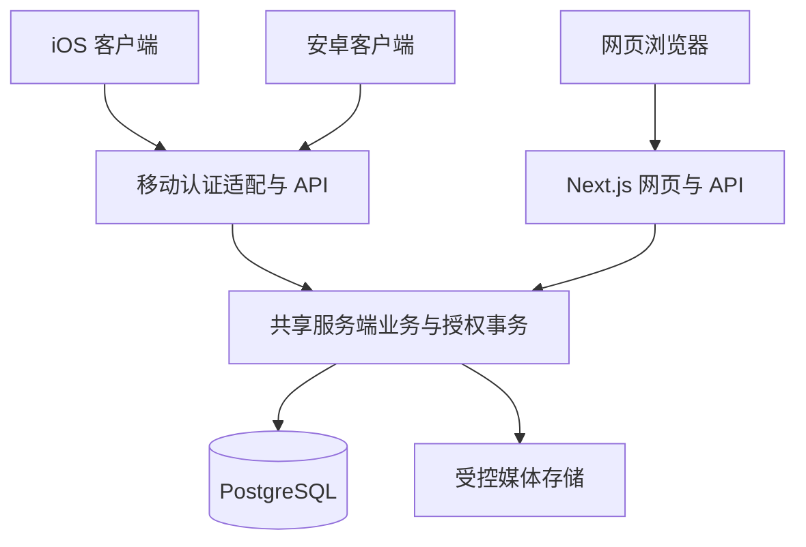

# InRole 收尾与网站、iOS、安卓发布指南

更新：用户2026-11-25随后取消内测，改为直接上线国内外可访问的网站，移动端后置。当前优先执行[网站直接上线三步方案](InRole网站直接上线三步方案.md)。本文保留为历史及移动端长期参考，不再要求先完成内测招募。

版本：V1.0。编写与官方资料核对日期：2026-11-25，北京时间。

用户已选择：**先做小范围内测，再决定首发地区。** 当前目标是把本地已有成果整理成可维护的内测版本，收集反馈后决定公开网站与手机应用的发布范围。本指南是后续执行计划，不表示已部署或已提交商店。

建议顺序：代码收尾 → 本地验收 → 可控外网内测 → 地区与运营主体决策 → 网站公开发布 → 手机端技术验证 → 安卓和iOS测试 → 商店发布 → 持续维护。

## 阅读方式与当前起点

本指南用R01～R22编号，避免覆盖原S01～S18开发计划。R01～R06主要对应S16与发布前补齐；R07～R12对应S17/S18；手机端属于新增范围。每步通过验收后再记录完成，不能只按“写了代码”勾选。

| 已有成果 | 当前事实 |
| --- | --- |
| 技术基础 | Next.js、React、TypeScript、Prisma、PostgreSQL；同一项目包含网页与服务端API |
| 主要业务 | 真实ID密码认证、喜好、帖子/评论/点赞、媒体、投票、引用、评分、通宝/流水、热搜/推荐、个人中心、管理与审计已经本地接通 |
| 界面 | 原版主要布局已接回；完整功能对应关系、英文词条和真实手机体验仍需收尾 |
| 最近验证 | 46项规则、16项数据库、13组读取、24组认证、26组社区场景有通过记录；本次前一轮重新执行check通过 |
| S16 | 仍未完成；最后浏览器回归中断，重试按钮修复后复验、真实手机和慢网待补 |
| 交付状态 | 大量S08及后续改动仍在工作区，尚未整理成新的提交/推送版本 |
| 发布状态 | 本地真实入口为http://localhost:3100/live；没有已验收的公网部署或商店应用 |

后续保留ID+密码、公共人物每次独立选择、公开显示“人物 · @账号”、北京时间每日通宝、游客只读等现行规则。通宝首版继续免费获得，不新增充值、提现、交易或现金兑换。

执行分工：Codex可完成代码、脚本、测试、文档、可审查配置；你负责设备实测、运营决策、开发者身份验证、账号与域名持有、付款、签约及实际用户招募。项目继续停用浏览器/电脑自动化链路，采用本地命令与HTTP/数据库检查，UI提供人工验收步骤。

## 第一段：把本地版变成可交付的版本

### R01 确认首轮内测范围

**你来决定：**第一批邀请5名熟人，下一批根据反馈扩大到约20人；使用什么设备；谁处理举报；每天能投入多少维护时间。

**具体执行：**

1. 写一页首版范围：四大模块、现有媒体和管理功能；明确本轮不增加私信、直播、复杂AI推荐或付费系统。
2. 记录待修问题，按“数据/权限错误、流程阻断、体验问题、未来功能”排序。
3. 选择一个内测入口，避免用户误入演示站；界面标注内测，反馈附版本号和请求编号。
4. 如果控制邀请规模，设计服务端邀请开关或邀请代码，限制注册和写入；不能仅靠“不公开网址”。邀请码不得绕过鉴权、限流和账号唯一性。

**交付：**内测范围、问题清单、参与者安排。**通过条件：**能明确回答“这版做什么、谁能进入、出问题找谁”。

### R02 先保存已有成果，形成可回退基线

**Codex执行：**检查Git全部已跟踪/未跟踪改动，整理代码和验收资料；保留现有数据库迁移，不删除工作区来追求干净状态。

**具体执行：**

1. 保存当前代码快照，备份开发数据库和媒体；备份放仓库外并限制访问。
2. 检查忽略规则：环境变量、密钥、数据库文件、测试夹具凭据、上传媒体不得进入Git或镜像。
3. 按实际范围整理提交；核对锁文件与新增迁移完整性，记录基线提交号。
4. 在独立检出目录验证安装、构建；检查Windows路径、大小写和Linux兼容问题。
5. 后续同步GitHub时只推送审查过的代码与文档。发现已泄露密钥先轮换，再处理历史，不能只删除当前文件。

**交付：**可恢复的基线、提交清单、备份位置说明。**通过条件：**原目录之外也能按README启动；备份确实可读取。

### R03 逐项核对原前端与真实页面

创建功能对应表，每个入口记录“演示有/真实有/缺失/故意暂缓/已实测”。先修缺失流程和按钮，再调整装饰。

| 页面 | 必须核对 |
| --- | --- |
| 首页/发现 | 搜索、推荐/最新、话题、分页、空内容、刷新 |
| 发帖/详情 | 人物、正文、图片/视频、投票、引用、草稿、分享、评论独立人物、删除权限 |
| 人物/评分 | 搜索与选择器、评分修改/删除、头像来源、评价分页、人物投币 |
| 热搜/榜单 | 帖子与话题、24小时/7天、人物评分和通宝统计、隐藏后同步 |
| 钱包 | 每日领取、赠送实际贴主、禁止自赠、余额、汇总和分页流水 |
| 个人/设置 | 本人和公开资料区分、活动、喜好、改密、恢复码、退出、语言/主题/字号 |
| 管理 | 人物/头像、申请、举报、隐藏、封禁、话题、填写原因和审计 |

明确公开首页策略：目前根路径是演示；正式发布前决定根路径进入真实社区还是产品介绍页，演示保留明确路径及标识。更新导航、分享链接、登录回跳、搜索收录和文档，不能只修改一个首页文件。

**交付：**页面对应表与修复记录。**通过条件：**没有无说明的失效入口；真实失败不显示演示数据或假成功。若本轮只发布中文，明确标注语言范围。

### R04 补齐社区发布所需的账号与治理能力

目前检索源码，尚未看到完整的用户自主屏蔽和账号注销流程，需新增并验收；已有举报、管理员封禁不能替代全部用户控制。

**具体执行：**

1. 实现用户屏蔽/解除屏蔽及列表；按实际@账号生效，换扮演人物不能绕过。明确帖子、评论、引用、推荐和互动的处理方式，服务端查询执行规则。
2. 实现账号注销：确认身份 → 明确说明影响 → 提交 → 撤销全部会话 → 执行删除/匿名化 → 显示结果。不能只“停用账号”就声称删除完成。
3. 为公开资料、内容、媒体、会话、恢复码、举报和钱包关联数据制定处理表；确有合法保留依据的数据写明用途与期限，不能以“审计”为由无限保留全部身份数据。兼顾其他用户流水一致性和隐私，必要时匿名化，并补事务/并发测试。
4. 提供站内注销入口，以及可在外部浏览器访问的账号删除申请页面；核验身份但不公开暴露账号信息。
5. 完善社区规则、举报分类、管理处理队列、申诉与联系渠道；制定图片/视频/文字内容的检测、待审和人工复核策略。
6. 整理隐私政策、用户协议、第三方SDK清单、数据保留说明；实际收集内容与文案一致。上传图片评估去除位置等非必要元数据。
7. 明确人物扮演标识，禁止冒充本人/官方；逐项核对头像、Logo、人物介绍、用户上传素材的使用依据。历史人物不意味着现代画像或照片可以任意使用；免责声明不能替代授权。
8. 确定年龄范围和未成年人处理办法；公开社交应用的年龄与儿童安全要求在提交前按地区和商店实际分类复核。

**依据：**Apple的UGC条款要求过滤、举报处置、屏蔽与联系方式，并要求应用具有足够使用价值；Google也要求持续UGC治理。见[Apple审核指南](https://developer.apple.com/app-store/review/guidelines/)与[Google UGC政策](https://support.google.com/googleplay/android-developer/answer/9876937)。账号删除分别见[Apple说明](https://developer.apple.com/support/offering-account-deletion-in-your-app/)与[Google用户数据政策](https://support.google.com/googleplay/android-developer/answer/10144311?hl=en)。

**交付：**新增流程、数据处理表、治理操作手册、政策网页。**通过条件：**普通用户能实际屏蔽和发起删除；管理员能及时处理举报；删除不会留下有效旧会话。

### R05 完成S16，补齐真实设备和故障验收

**命令基线：**以下在项目目录执行。数据库测试使用脚本自己的隔离库和已配置测试环境，禁止指向正式库；执行前阅读脚本的环境要求。

```powershell
npm.cmd run check
npm.cmd run verify:s07b
npm.cmd run verify:s07c
npm.cmd run verify:s08
npm.cmd run verify:community
```

check已包含lint、类型、规则测试和构建；部分集成脚本需要本地PostgreSQL和构建产物。记录每条命令的退出码，不能用最后一个命令成功掩盖前一个失败。

**人工必测：**

1. 游客阅读 → 注册 → 喜好保存/跳过 → 发帖 → 换人物评论 → 点赞 → 评分 → 投币/赠送 → 钱包 → 举报 → 管理处置。
2. 两个普通账号和一个管理员账号，核对本人/他人/游客权限；管理员账号只在受控环境配置。
3. 隔离环境模拟断库，发帖失败保留草稿；恢复后点击“重新读取数据”不自动提交；显式发布后仅出现一篇。
4. 模拟成功响应丢失，用原幂等键重试，帖子和扣币只生效一次；并发投币不超余额。
5. iPhone Safari、安卓Chrome/目标内置浏览器、电脑浏览器，实际检查软键盘、返回、旋转、字号、触控和长文本。
6. 慢网、切网络、上传中断、会话过期、应用/网页切到后台再回来；失败时文案准确。
7. 隐藏后核对直链、引用、媒体、热搜和推荐，不能残留公开访问途径。

**交付：**通过/失败/未做三类结果、版本号、设备和网络、缺陷修复证据。**通过条件：**数据/权限错误和核心流程阻断清零；未测项明确列出。不会为了通过测试而清空开发库。

### R06 整理可重复构建、CI和发布记录

**具体执行：**

1. 固定受支持的Node、包管理器和依赖版本；后续更新先在测试分支验证。现有Node24容器配置需要实际Linux构建。
2. 在干净环境执行安装和check；验证Argon2、sharp、ffprobe等本地二进制在目标系统和CPU架构能运行。
3. 配置CI：每次改动运行lint/类型/规则/构建；数据库集成使用临时数据库和测试密钥。合并后先到预发布，正式发布保留人工确认点。
4. 维护迁移、部署、环境变量说明和发布日志；新增健康检查与就绪检查，错误响应不泄露内部配置。
5. 检查依赖安全公告和生产依赖审计；修补可触达问题并回归，不能凭一次“0漏洞”长期免检。

**交付：**CI配置、可复现镜像/产物、发布清单。**通过条件：**一次失败检查会阻止发布；无需复制个人电脑中的秘密文件即可重建。

## 第二段：外网内测与网站发布

### R07 决定内测接入方式和环境隔离

推荐先使用一套独立的外网内测环境：一台持续运行的Node服务、独立PostgreSQL、受控持久媒体存储、HTTPS入口、邀请限制。小规模阶段先单实例，按实测再扩容。

| 项目 | 开发 | 外网内测 | 正式 |
| --- | --- | --- | --- |
| 数据库/媒体 | 本机 | 独立测试资源 | 独立生产资源 |
| 密钥/账号 | 开发专用 | 内测专用 | 生产专用 |
| 域名/访问 | localhost | 独立子域或预览域，限制邀请 | 自有域名与公开规则 |
| 数据用途 | 开发 | 知情参与者的最小必要数据 | 已公开承诺的业务数据 |

云账号、域名、账单和备份的最终控制权由你持有，开启多因素认证与费用提醒。内测也需要隐私告知和适用要求，邀请制不会自动免除这些责任。

**交付：**资源拓扑、区域候选、配置和月度费用上限。**通过条件：**开发、内测、正式环境不会相互误连；你批准资源后才购买或创建收费项。

### R08 处理当前部署架构中的媒体约束

现有媒体保存到服务端文件目录；直接部署到临时磁盘或多个互不共享磁盘的实例，会导致重启丢文件或部分请求读不到媒体。

可选路线：

- **首轮内测：**单实例Node + 持久卷 + 媒体备份。保留当前受控读取逻辑，先验证重启和重新部署后文件仍可用。
- **准备扩容：**实现私有对象存储适配器；数据库存对象标识，鉴权后读取或签短期URL。定义隐藏/删除失效时限，不能让旧公开缓存绕过内容治理。

两条路线都要验证：媒体最大尺寸、实际MIME、解码失败、视频Range播放、未关联临时上传清理、隐藏/删除、备份和容量告警。反向代理上传限制给multipart开销留空间，同时保持应用自身的5MiB图片/30MiB视频限制，不靠放大网关上限绕过校验。

**交付：**媒体运行与备份方案。**通过条件：**发布新版本不丢文件；任何实例都能按权限获得正确媒体；隐藏内容按承诺失效。

### R09 把版本部署到内测环境

**具体顺序：**

1. 选择支持持续Node进程、目标区域PostgreSQL和持久媒体的环境；确认所用数据库支持项目的角色权限、函数和迁移。
2. 创建独立数据库与受限应用账号；应用不使用数据库拥有者权限。迁移任务单独获得DIRECT_URL。
3. 从批准的Git版本构建镜像，实际执行容器构建；检查镜像不含.env、备份或测试凭据。
4. 注入DATABASE_URL、APP_ORIGIN、SESSION_PASSWORD、RATE_LIMIT_SECRET、RECOVERY_CODE_PEPPER和媒体目录等配置。密钥独立持久保存，不能每次部署随机更换；密钥轮换另走方案。
5. 用迁移任务部署迁移和项目权限；不要对正式库执行db:local:setup或隔离库验证脚本。
6. 配置反向代理、HTTPS、上传限制、超时、进程重启和日志。应用/数据库端口保持内网，公开入口统一HTTPS。
7. 核对精确APP_ORIGIN、可信代理IP头、Secure Cookie；不能为方便访问而关闭Origin验证。
8. 审核并导入公共人物/兴趣/话题；现有db:seed:catalog仅限本机，不直接拿来灌正式库。不要复制演示账号、帖子、钱包。
9. 创建站长真实账号，受控终端提升管理员，重新登录并保存恢复码；不将管理员功能开放给普通账号。
10. 从外网手机注册测试账号，检查读写、媒体、幂等、退出与隐藏；重启服务后复测会话、文件和数据。

自托管结构可参考[Next.js自托管指南](https://nextjs.org/docs/app/guides/self-hosting)。当前Dockerfile是准备材料，不能在实际构建和运行前宣称容器部署已经完成。

**交付：**可访问的内测HTTPS入口、版本号、配置清单和部署证据。**通过条件：**关闭开发电脑后，内测服务仍可运行；跨设备数据一致；无秘密进入客户端或日志。

### R10 配置备份、监控、容量与回滚

**具体执行：**

1. 约定恢复目标，例如首轮内测最多丢24小时数据、4小时内恢复，作为暂定RPO/RTO；后续根据真实能力和用途调整。
2. 自动备份数据库与媒体，保留仓库外、主机外副本；具备条件时开启PITR。小规模可先在停写窗口取得一致快照。
3. 恢复到新数据库和新媒体位置，核对账号、帖子、图片/视频、余额与流水；记录耗时。恢复演练不覆盖运行中的正式环境。
4. 监控HTTP错误率、响应时间、数据库连接、磁盘/媒体容量、上传失败、备份结果和费用；设可收到的告警渠道。
5. 保存上一版镜像和部署配置，验证应用回滚；数据库采用兼容的追加迁移，不能假设回退镜像就会回退数据。
6. 提供紧急停注册、停上传/写入或维护模式；保留用户草稿提示和恢复说明。

**交付：**备份任务、真实恢复报告、告警规则、回滚步骤。**通过条件：**能在目标时间内恢复一份可使用的副本，并能及时发现服务或备份失败。

### R11 开始5人内测，再根据结果扩到约20人

先让每人独立使用，不边操作边口头教按钮。记录设备、网络、版本、操作、预期/实际、截图、请求编号；截图避免密码和恢复码。

| 参与者 | 任务 |
| --- | --- |
| A 手机Wi-Fi | 注册、选喜好、发帖、刷新、再次登录 |
| B 手机蜂窝 | 跳过喜好、评论换人物、点赞取消、弱网重试 |
| C 电脑 | 评分修改/删除、人物投币、赠送、双方钱包核对 |
| D 不同系统手机 | 图片/视频、投票、引用、分享、键盘与返回 |
| E 多设备 | 恢复码、会话撤销、屏蔽/解除屏蔽、注销申请 |

你或专门测试员补做管理员处理，普通内测用户不必获得管理权限。24～72小时后询问是否愿意再次访问、哪里不理解。真实参与和反馈有价值，预设示例内容不能冒充活跃用户。

**发布门槛：**每条关键流程有人完成；重复扣币、越权、数据泄露与数据丢失等问题清零；严重阻断已修复并复测；剩余问题有明确优先级。达标后再扩大邀请。

### R12 根据内测结果决定地区，再公开网站

这是正式公开前的决策点：首发地区、个人/组织运营主体、公开注册规模、数据处理区域、媒体范围、年龄范围、维护负责人。

**中国大陆路线：**

- 根据服务性质核对网站备案/许可和APP备案，以及适用的公安联网备案、内容服务资质或安全评估要求。不能把“免费社区”直接等同于任何个人备案都可运营；具体分类交由接入商、属地主管部门或合格专业人员确认。
- 现行产品是ID+密码、不收手机号。大陆公开信息发布服务涉及真实身份认证要求，这是需要明确解决的产品决策：可以保留公开ID及密码登录设计，但私下认证方式、数据最小化和开通发言条件需另行设计并批准。当前规则不能直接被宣称已满足大陆公开运营条件，也不在本指南中擅自更改注册流程。
- 人物扮演的展示方式及头像权利一并评估；对内容与媒体能力确认适用资质后再开放，不能以境外主机或邀请制作为规避依据。

政策依据：[互联网信息服务管理办法](https://cqca.miit.gov.cn/zwgk/zcwj/flfg/art/2026/art_3aa3d50dbe1648fda74aeab4f39b2db1.html)、[工信部APP备案通知](https://www.miit.gov.cn/zwgk/zcwj/wjfb/tz/art/2023/art_920db564162e4312916a01bed6540ad8.html)、[账号信息管理规定第九条](https://www.cac.gov.cn/2022-06/26/c_1657868775042841.htm)。以上为发布核对事项，不是已经取得资质的结论。

**海外路线：**选定具体国家/地区后核对隐私、儿童安全、内容举报、数据跨境和消费者规则；“海外”并非统一法律区域。测试目标用户实际网络体验，避免把依赖不可达服务带入客户端。

**公开发布顺序：**购买/绑定持有的域名 → 完成适用手续 → 配置DNS和HTTPS → 验证正式环境 → 核对隐私/协议/客服/注销网页 → 发布明确版本 → 小规模公开 → 观察指标再扩量。根路径、分享域名、搜索收录、404/500和演示隔离一并验收。

**交付：**地区与主体决定、合规材料清单、正式网址、发布日期和回滚负责人。**通过条件：**普通外网用户可稳定访问并知道如何联系、举报和删除账号；适用手续完成。

## 第三段：先验证手机端路线，再扩展全部界面

### R13 可选：先提供可添加到主屏幕的网页

网站稳定后，可新增PWA的manifest、图标、启动体验、离线提示和更新提示，让部分用户先通过主屏幕入口使用。它是网站体验的增强，不等于已经获得App Store或安卓商店上架。

Service Worker不能默认缓存所有API：登录状态、钱包、管理员、恢复码等私密响应不得跨账号复用；退出后清理相应缓存。首版离线时保留草稿并明确无法提交，不能显示写入成功。

**交付：**主屏幕入口与明确的联网/离线状态。**通过条件：**图标和启动路径正确，更新后不会长期加载旧页面，不缓存他人私密数据。若内测用户不需要，可以跳过此步。

### R14 用一个小版本决定移动端技术路线

**建议优先验证Capacitor，并保留React Native/Expo作为评估选项。**这是基于现有React网页和样式的工程建议，最终取决于真机验证结果。

| 路线 | 可以复用 | 需要新增或改造 | 适用情况 |
| --- | --- | --- | --- |
| Capacitor + 独立客户端构建 | 大量React展示组件、CSS、类型、规则和API模型 | Next专用路由/服务端依赖拆分、移动认证、原生桥接、手势/权限/商店工程 | 优先复用现有界面且首版原生能力有限 |
| React Native/Expo | 服务端、类型、纯业务规则、部分数据访问设计 | 大部分DOM/CSS界面改写、原生导航与媒体组件 | 更重视长期原生交互、接受更大前端工作量 |
| 分别开发Swift/Kotlin | 后端与API协议 | 两套客户端UI与平台实现 | 有专门团队或明确平台深度需求 |

Capacitor提供iOS/安卓原生容器和插件能力，见[官方介绍](https://capacitorjs.com/docs)。其配置中的server.url主要用于开发热重载，官方明确不建议生产使用，不能只把线上地址写进去就当完成版，见[配置说明](https://capacitorjs.com/docs/config)。

现有Next.js中包含动态接口、Cookie和数据库，不能把.next目录直接塞进手机；也不能直接开启静态导出仍指望服务器能力一并运行。静态导出限制见[Next.js说明](https://nextjs.org/docs/app/guides/static-exports)。

**建议架构：**



共享业务服务继续在云端运行，手机不持有数据库连接或服务端密钥。网站与手机使用同一实际账号和账本；会话可以分别建立和撤销。

**验证版本只做：**登录、刷帖子、发一篇、选图上传、看视频、退出。至少一台安卓和一台iPhone实测。客户端静态资源使用独立构建入口，按需提取通用组件，不先大规模搬目录或改写整个网站。

**交付：**两端可安装的验证包、兼容性记录、方案决定。**通过条件：**登录能持久恢复，网络错误明确，媒体可用，网页没有退化；达不到时先评估替代路线，再投入全部页面。

### R15 为手机客户端建立受控认证和API访问

当前实现使用HttpOnly、Secure、SameSite=Lax Cookie，写入要求精确APP_ORIGIN，还检查Sec-Fetch-Site。这些设计不能直接假设支持独立客户端源或原生网络调用。

**具体执行：**

1. 编写移动会话协议，选择经验证的Cookie集成或专用移动令牌；分别记录iOS/安卓网络栈、WebView与媒体播放器的行为。
2. 若使用移动令牌：建立随机不可预测、可撤销的设备会话，规定过期/刷新/轮换和重放处理；数据库存适当摘要，不能自己发一个永不过期字符串。
3. 将必要凭据放入系统保护的安全存储，如Keychain/Keystore支持的安全存储适配；不要写入网页localStorage、日志、崩溃报告或仓库。删除账号、改密、封禁和退出必须覆盖移动会话。
4. API由明确版本的访问适配层调用，共享原有账号检查、授权事务、限流和幂等规则；不能复制一套少了权限校验的“App专用业务”。
5. 对客户端浏览器请求精确配置CORS和必要CSRF措施；专用移动端点明确验证会话。Origin不是身份凭据，不能通过任意Origin、伪造头或“原生请求无Origin就放行”完成接入。
6. 核对媒体请求、Range、图片加载和播放器如何携带授权。若使用短时签名地址，令牌不得进入长期日志，明确过期、隐藏和撤销行为。
7. 为重新登录、断网、刷新令牌并发、会话撤销、重复提交、两台设备同一账号补实质测试。

**交付：**移动认证/API协议、实现、集成测试和泄露检查。**通过条件：**多设备数据一致；关闭再开App能正确恢复；被撤销的凭据不能继续读私密数据或写入；客户端无数据库秘密。

### R16 完成手机应用体验和必要的平台能力

把R03的全部真实业务逐项接入移动客户端；保留人物和实际账号的区分。根据验证方案复用组件或重写界面。

**具体执行：**

1. 适配安全区、系统字体、底部导航、键盘避让、Android返回、弹窗关闭和横竖屏策略。
2. 连接系统照片/文件选择、可选拍摄、图片压缩和上传进度；权限在使用时申请，拒绝或仅授权部分照片时仍可操作其他功能。
3. 支持系统分享和经过验证的帖子深链接；站外链接交由合适浏览器打开，不把任意外站放进有原生权限的容器。
4. 做好本地草稿、断网提示、启动恢复和升级兼容，谨慎缓存私密内容。
5. 如内测确实需要通知，再新增服务端通知数据与推送队列、设备令牌、用户开关及撤销清理；iOS/海外安卓/大陆安卓的送达依赖需分别验证。拒绝通知权限不影响正常使用。
6. 图标、启动页、正式应用名、版本号、关于页、客服、举报、屏蔽和注销入口完整。
7. 如集成推送、分析、崩溃SDK，更新隐私文案、数据披露与平台配置；避免首版加入没有明确用途的SDK。

手机应用应有完整持续可用的社区体验。原生分享、媒体、深链接等可以改善使用，但添加某个插件本身不能保证通过Apple的最低功能审核，见[审核指南4.2](https://developer.apple.com/app-store/review/guidelines/#minimum-functionality)。

**交付：**具备首版范围的iOS/安卓候选版本。**通过条件：**用户不需要借助开发环境完成任何核心流程；权限拒绝、后台返回和弱网不造成数据误操作。

## 第四段：安卓构建、测试和发布

### R17 在Windows完成安卓正式构建和真机测试

**你准备：**Android Studio、合适的Android SDK/JDK、至少一台真实安卓手机和USB调试环境。版本以所选移动框架和插件的兼容要求为准，不混装不匹配工具链。

**具体执行：**

1. 固定applicationId包名，使用自己控制的反向域名形式；正式发布后不要随意修改。
2. 区分开发/内测/正式API地址和包配置，Release包不指向localhost、不含调试开关或开发凭据。
3. 配置最低系统、目标SDK、网络安全和所需权限；扫描第三方SDK声明是否过度。
4. 创建并离线备份签名材料、别名和密码，限制访问。Google Play上传密钥与应用签名密钥分别记录；其他渠道签名策略提前规划，避免用户后续无法原地更新。
5. 生成正式签名APK供允许的直接安装/部分渠道测试；Google Play准备AAB并配置Play App Signing。
6. 覆盖至少一台较低配置和一台常用新机；检验安装、升级不丢草稿/会话策略、冷启动、网络切换、上传、播放和崩溃日志。
7. 验证无Google服务设备上的启动和核心功能；不能把依赖FCM的功能直接当作大陆全设备覆盖。

截至本指南核对日，Google Play普通手机新应用/更新要求target Android 16、API 36或更高；这是目标API要求，不代表必须把最低可运行系统设为Android16。提交前重新查看[目标API要求](https://support.google.com/googleplay/android-developer/answer/11926878)。

**交付：**签名APK/AAB、密钥保管记录、安卓设备验收报告。**通过条件：**Release包能安装和升级，核心流程全通，包名/签名/版本正确，无开发环境依赖。

### R18 选择安卓发布渠道并完成材料与审核

**先内测：**邀请制分发签名测试包或使用商店内部测试。直接发APK也要安全托管、说明版本、保护下载来源，并验证升级；不等于所有设备/地区都无限制分发。

**Google Play路线：**

1. 注册开发者账号并完成身份、设备及适用组织资料验证。
2. 创建应用，上传AAB，配置签名、目标地区、内容分级、受众、广告声明、App access和Data safety。
3. 提供隐私政策、账号删除网页、客服、真实应用截图；需要登录时提供审核专用账号和完整步骤。
4. 先内部测试；适用新个人账号的，进行封闭测试并申请生产访问。
5. 修复预发布报告与实际反馈，申请生产发布，通过后按渠道支持的发布控制放量。

当前规则：2023-11-13之后创建的个人账号，生产访问前需至少12名测试者连续加入封闭测试满14天，再申请并回答测试问题。5人网页内测不能替代该要求，达人数/天数也不代表自动批准。见[Google测试要求](https://support.google.com/googleplay/android-developer/answer/14151465)。

**中国大陆商店路线：**

按R12确定主体与适用APP备案后，逐家核对开发者注册、类别准入、版权/软著等材料、隐私检测、SDK清单、测试账号、签名APK、截图和客服。可评估小米、OPPO、vivo、应用宝及适用华为分发渠道；各家审核和格式分别确认，不能一次提交默认全覆盖。华为官方材料入口示例：[发布流程](https://developer.huawei.com/consumer/en/doc/app/agc-help-release-app-guide-0000002287176372/)与[审核常见问题](https://developer.huawei.com/consumer/en/doc/50106)。

不要把所有华为设备和系统都当成兼容安卓APK；需要HarmonyOS专有应用时，另立客户端支持范围并核对该平台开发方案。

其他分发也需关注[Android开发者验证](https://developer.android.com/developer-verification)在目标地区、设备和渠道的适用范围，不能用“不走Play”推断无需身份与应用验证。

**交付：**已通过测试的渠道包、逐渠道材料清单、审核反馈与发布记录。**通过条件：**真实目标用户能安装、更新、登录、举报及发起注销，商店信息与实际应用一致。

## 第五段：iOS构建、TestFlight和App Store

### R19 准备Apple账号、Mac构建环境和签名

**你准备：**Apple账号、多因素认证、真实身份与联系资料、可用iPhone；Mac或受控macOS云构建环境。Windows可以继续开发共享代码和安卓，但不能直接运行Xcode完成本机iOS正式构建。

**具体执行：**

1. 先决定个人或组织开发者账号。Apple个人账号的法定姓名会显示为卖方；组织有实体资格与额外验证要求，不能只填品牌名当组织。见[注册要求](https://developer.apple.com/programs/enroll/)。
2. 开通Apple Developer Program，配置App Store Connect访问权限，避免共享主账号密码。
3. 在Mac配置所需Xcode、命令行工具和所选框架依赖；没有Mac时先评估租用/云构建，仍安排真实设备调试。
4. 注册固定Bundle ID，与应用名、团队、证书、描述文件和Capabilities对应。
5. 配置正式HTTPS后端、必要权限用途说明、Universal Links等；使用推送时配置对应能力和服务端凭据。
6. 明确钥匙串、证书、分发密钥和App Store Connect API密钥的保管与轮换责任，不提交仓库。

Capacitor的macOS/Xcode要求见[环境说明](https://capacitorjs.com/docs/getting-started/environment-setup)。截至核对日，Apple要求上传构建使用Xcode26或更高及iOS26 SDK或更高；最低部署系统另按框架和产品设备范围决定，提交前查看[最新要求](https://developer.apple.com/news/upcoming-requirements/)。

**交付：**可签名、可安装到iPhone的Release构建。**通过条件：**签名和Bundle ID正确，真机能够使用正式候选后端，所需权限说明真实准确。

### R20 上传TestFlight，完成iPhone真实内测

**具体执行：**

1. 创建App Store Connect应用记录，填写Bundle ID、SKU、主要语言和初步资料。
2. Archive并上传构建，完成处理后的相关声明；检查版本号和build号不重复。
3. 配置测试说明、反馈邮箱、测试账号；先内部测试，再按规则申请外部测试。外部测试涉及Beta审核，不能只上传就假定邀请立即可用。
4. 邀请真实iPhone用户测试注册、媒体、评分、通宝、举报/屏蔽/注销、深链接、后台返回、升级和弱网。
5. 检查Safari网站和App内同账号的状态一致；会话应遵循各自的生命周期，改密/封禁等撤销规则一致。
6. 处理崩溃和反馈，更新构建并复测；把“TestFlight可安装”和“App Store审核通过”分别记录。

官方入口：[TestFlight流程](https://developer.apple.com/testflight/)。

**交付：**已获真实用户反馈的候选构建。**通过条件：**核心流程和新增平台能力有人真机完成，严重崩溃/阻断清零，版本与后端协议兼容。

### R21 准备App Store资料，提交审核并处理反馈

**材料顺序：**

1. 应用名、副标题、介绍、关键词、分类、年龄分级、图标、真实设备规格截图；推广图不能伪造尚未实现的功能。
2. 隐私政策、支持网页、联系方式、账号注销入口；隐私披露按实际代码及SDK填写，不能把“没有手机号”写成“不收集任何数据”。
3. 检查隐私清单、SDK签名、required-reason API等适用要求；加密出口声明按实际使用和适用豁免回答，不能机械复制答案。
4. 明确InRole为人物扮演社区、发言显示实际@账号，通宝首版为免费站内积分；准备头像/品牌等权利说明。
5. 提供审核专用普通账号、可用后端和操作说明，写明举报、屏蔽、注销在哪；不要提供生产管理员凭据。必要的审核测试数据应合法、明确标记并与运营数据区分。
6. 选择目标地区，补齐对应地区的备案/许可等材料；中国大陆发行按R12核对，不能用其他地区审核通过替代。
7. 提交后逐条回应问题，修复实际代码或材料后再提交；审核期间后端持续可用，不做只对审核员展示的隐藏版本。
8. 通过后选择合适的手动发布和地区范围；首发先控制推广和注册量，更新时按可用渠道使用分阶段发布。

第一版保持现有免费通宝规则。将来若引入充值、会员或其他数字商品，再单独设计计费、服务端验单和平台政策适配，不预先通过网页外链默认绕开商店支付规则。

**交付：**商店记录、审核说明、获批版本、发布安排。**通过条件：**指定地区用户可下载，审核承诺与实际行为一致，客服和后端有人维护。审核结果和时间不能承诺。

## 第六段：三端发布之后

### R22 用同一套发布与运营流程维护网站、iOS、安卓

**每次发布：**

1. 先写变更与风险，定义后端支持的客户端版本范围；旧App不会随着网站更新自动升级，API不能随意破坏兼容。
2. 完成代码检查、实质业务测试、数据库迁移演练和目标设备抽查；备份通过后再发布。
3. 先兼容地升级服务端，再发布客户端；需要强制升级时提前设计提示和合理的可用范围。
4. 记录Git提交、镜像/包版本、迁移版本、发布时间、负责人、监控窗口和回滚方式。
5. 关注注册/引导完成、首次发帖、媒体成功、崩溃、读写错误、钱包异常、举报积压和实际再次访问；只采集必要数据并在隐私说明中披露。
6. 修复顺序：数据与权限 → 核心流程阻断 → 常见体验 → 新功能。发生钱包异常时可先停相关写入，保留证据，不改库伪造正常余额。
7. 定期恢复演练、依赖/SDK更新、证书和域名续期、账号权限检查、材料与商店声明更新。
8. 内容审核、用户申诉、删除请求和数据保留由明确人员持续执行，不能在首次审核通过后停止。

**最终交付包：**网页地址；各渠道App链接/版本；源码提交；构建与部署说明；数据库迁移；配置项名称与安全保管方式；数据库/媒体恢复说明；签名与账号归属记录；隐私/协议/客服；测试与发布记录；已知限制。

**通过条件：**另一个被授权的维护者能够依据文档重建、部署、恢复和发布更新；你仍掌握域名、开发者账户、源代码、数据和账单。

## 工具和账号准备表

| 何时准备 | 工具或资源 | 用途 | 由谁操作 |
| --- | --- | --- | --- |
| 现在 | 现有Node/npm、Git、编辑器、PostgreSQL | 本地收尾、测试、代码管理 | Codex和你 |
| 外网内测前 | 云账号、HTTPS入口、独立库、持久媒体、备份与费用告警 | 电脑关闭后仍能运行的内测 | 你持有账号；Codex准备配置 |
| 网站公开前 | 自有域名、运营主体/地区决定、适用手续与政策网页 | 公开发布 | 你确认和持有 |
| 安卓验证时 | Android Studio、SDK/JDK、安卓手机 | 编译与真机测试 | Codex准备工程；你安装/授权设备 |
| iOS验证时 | Mac或macOS构建服务、Xcode、iPhone | 编译、签名与测试 | 你提供环境与账号 |
| 商店测试前 | Apple Developer、按渠道需要的安卓开发者账号 | TestFlight/商店测试与发布 | 你验证身份、付款和签约 |
| 确定移动路线后 | Capacitor或最终选定框架和必要插件 | 客户端工程 | Codex按锁定版本接入 |

不需要为了完成这些阶段同时下载很多AI工具；现有开发工具足够推进代码。对身份验证、付款、合同、真实手机操作和审核结果，AI不能代替你承担账户主体责任。

## 时间与费用如何安排

下面是基于现有代码的规划估算，假设一名开发者持续推进、设备和账号及时可用，不是工期承诺。内测发现的问题、地区手续和审核等待会改变排期。

| 工作 | 建议预留 | 前置条件 |
| --- | --- | --- |
| R01～R06本地收尾 | 1～3周 | 当前代码完整；能安排两类真机 |
| R07～R11外网内测与反馈修复 | 1～3周 | 云环境批准、测试者可参与 |
| R12网站公开决策与发布 | 工程约数天～1周；手续另计 | 地区/主体和适用手续确定 |
| R13～R16手机技术验证与功能接入 | 3～6周或更长 | 稳定API；新增移动认证可验收 |
| R17～R21移动测试与商店流程 | 2～4周或更长，可部分并行 | 账号、签名、Mac、测试者、材料齐备 |

兼职按实际每周可投入时间延长。Google适用封闭测试至少14天；备案、组织认证和商店审核不纳入可控制的开发工时，不能把三端发布承诺为几天完成。

费用方面：Apple Developer Program目前为99美元/会员年或当地货币，见[官方费用](https://developer.apple.com/programs/whats-included/)；Google Play目前为25美元一次性注册费，见[官方注册指南](https://support.google.com/googleplay/android-developer/answer/6112435)。地区、税费和账户实际结算另核对。

云服务按“计算 + 数据库 + 媒体容量 + 下行流量 + 备份 + 监控 + 可选内容审核”列预算；视频流量可能超过计算费用。Mac购买/租用、iPhone/安卓设备、域名、适用主体与手续成本单列。先在R07收集目标区域报价并设置月度上限，再购买，不把促销价当长期费用。

## 可以直接发给Codex的分阶段任务

以下是后续可使用的任务文本，不代表本指南已经执行了这些动作。购买、身份认证、正式公开与商店提交前，先把代码、配置和材料做到可审查，再由你完成相应决策。

**第一轮：本地收尾。**

> 按《InRole收尾与网站及移动端发布指南》执行R01～R06。先核对原前端与真实页面，补齐屏蔽和账号注销方案与实现，完成S16实质测试、真实设备人工验收清单、Git与文档整理。保持ID密码和免费通宝规则；停用浏览器/电脑自动化。逐项记录通过、失败、未测，不部署或购买资源。

**第二轮：准备外网内测。**

> 执行R07～R10。先提交区域候选、资源和费用方案，准备可审查的部署、持久媒体、独立数据库、邀请控制、备份恢复与回滚配置。用目标环境实测后再记完成，保持生产与开发数据隔离。

**第三轮：内测与网站发布决定。**

> 执行R11，准备5人任务表，收集真实反馈并修复前三类阻断问题，再依据R12列出首发地区与主体需要我决定的事项。正式公开前核对权限、隐私、内容治理和适用手续。

**第四轮：手机验证。**

> 按R14～R15先做手机最小验证版本，评估Capacitor复用现有界面，测通iOS/安卓登录、读帖、发帖、图片、视频和退出。提交移动认证与API安全方案，不放宽原有全站Origin保护。通过后再按R16扩展全部界面。

**第五轮：测试与商店材料。**

> 按R17～R21分别整理安卓和iOS候选包、签名说明、测试记录、隐私披露与审核材料，区分大陆和海外渠道。先完成测试与可审查提交材料，列明需要我进行身份验证、付款或正式提交的操作。

## 完成状态总表

| 里程碑 | 可以称为什么 | 不能据此称为什么 |
| --- | --- | --- |
| R01～R06通过 | 可交付的本地候选版 | 已上线、已完成真人内测 |
| R07～R11通过 | 可控外网内测版，有真实反馈 | 已满足所有地区公开发布要求 |
| R12通过 | 指定地区可公开使用的网站 | iOS/安卓已上架 |
| R14～R17通过 | 可安装且测试过的手机候选版 | App Store/全部安卓渠道已批准 |
| R18或R21通过 | 对应渠道和地区已发布 | 所有地区/设备/商店均支持 |
| R22持续执行 | 可维护的三端服务 | 后续无需运营和维护 |

本指南保留为发布路线图；实际完成情况继续以进度清单与每轮verification证据为准。
