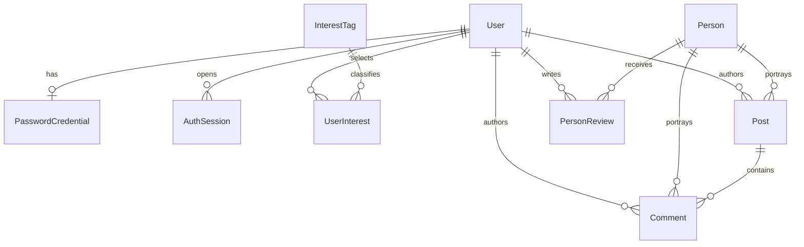
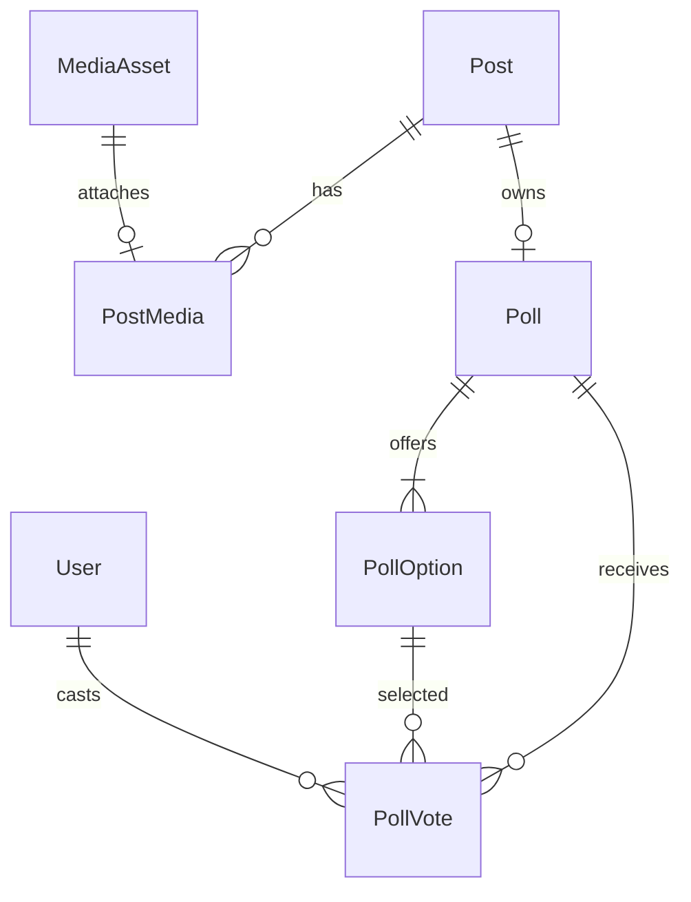
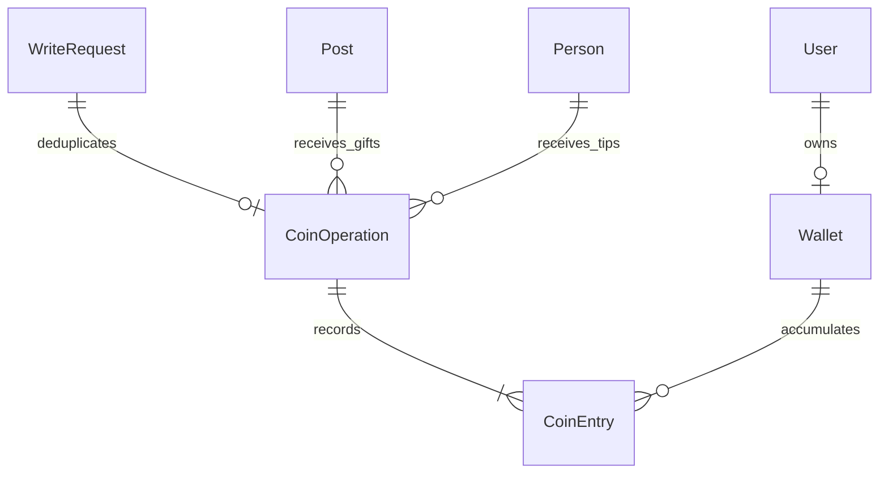

# S07A 数据关系与约束设计

日期：2026-11-24。范围：本地设计、Prisma模型验证、认证与Next.js兼容性验证。S07B执行数据库迁移，S08接真实认证页面，S10～S15接业务。这里定义关系，不表示这些业务已上线。

可校验模型：`prisma/schema.prisma`。所有业务表和枚举置于独立的`inrole` PostgreSQL schema。当前没有执行建表、迁移、数据库清空或演示数据导入。

## 核心身份与内容关系

实际账号、公共人物、兴趣是独立实体。帖子和评论各自持有`authorId`与`personId`。不在User上保存一个用于反推历史发言的“当前人物”。`UserRecentPerson`仅提供最近使用入口。

账号内部ID使用UUID；公开handle按原有规则归一化，首版不可修改。人物和话题保留如`libai`、`history-work`的稳定slug，便于复用现有资源映射。真实帖子使用新UUID，不自动沿用浏览器演示帖ID。

## 31张表的职责

| 模型 | 主要字段及关系 | 数据库已有的结构约束 |
| --- | --- | --- |
| User | handle、昵称、简介、角色、状态、authVersion、引导完成时间 | UUID主键，handle唯一，角色默认USER |
| PasswordCredential | userId、passwordHash、changedAt | userId一对一，独立凭据表 |
| AuthSession | userId、tokenHash、authVersion、expiresAt、revokedAt | tokenHash唯一，用户与有效期索引 |
| RecoveryCode | userId、codeHash、usedAt | codeHash唯一，仅预留S17恢复能力 |
| RateLimitBucket | scope、keyHash、windowStart、count、expiresAt | 复合主键，过期清理索引 |
| InterestTag | 稳定标签ID、名称、启用状态 | 标签ID主键 |
| UserInterest | userId、interestId | 每个用户同标签一次 |
| Person | 稳定ID、姓名、别名、简介、主要分类、启用状态、头像关系 | 人物ID主键，主要分类与头像外键 |
| PersonSource | 人物、来源、作者、许可、修改说明 | 人物外键，保留多个出处 |
| PersonInterest | 人物与兴趣标签 | 人物标签组合唯一 |
| UserRecentPerson | 用户、人物、最后使用时间 | 用户人物组合唯一 |
| Topic | 稳定ID、名称、简介、启用状态 | 名称唯一 |
| TopicInterest | 话题与兴趣标签 | 话题标签组合唯一 |
| Post | authorId、personId、正文、quotePostId、可见性、时间 | 独立作者/人物外键，自引用外键，列表索引 |
| PostTopic | 帖子与话题 | 帖子话题组合唯一 |
| Comment | 帖子、实际作者、本次人物、正文、可见性、时间 | 一级评论外键，评论列表索引 |
| PostLike | 用户、帖子、点赞时间 | 用户帖子复合主键 |
| PersonReview | 用户、人物、分数、正文、可见性、时间 | 用户人物组合唯一 |
| MediaAsset | 上传人、用途、状态、bucket、storageKey、类型、大小、来源署名 | storageKey唯一，归属与状态索引 |
| PostMedia | 帖子、媒体、排列位置 | 媒体仅绑定一篇帖，帖内位置唯一 |
| Poll | 所属帖子、问题、截止时间 | postId一对一 |
| PollOption | 投票、选项、归一化文本、位置 | 帖内位置和归一化选项分别唯一 |
| PollVote | 用户、投票、选项、时间 | 用户投票主键，复合外键确保选项属于该投票 |
| CharacterRequest | 申请人、名称/简介/网址、去重键、审核人、目标人物 | 用户去重键唯一，审核关系外键 |
| ContentReport | 举报人、帖子/评论/评价目标、原因、处理状态 | 三类目标分别可去重并有外键 |
| ModerationAction | 管理员、动作、目标、原因、前后状态、时间 | 目标与操作者索引，保留操作历史 |
| WriteRequest | 用户、scope、key、payloadHash、执行状态、结果ID | 用户+范围+幂等键唯一 |
| Wallet | userId、余额缓存、更新时间 | userId一对一 |
| CoinOperation | 发放/人物投币/帖子赠送、发送者、接收者/人物/原帖、数量、领取日、请求 | 用户领取日期唯一，写请求一对一 |
| CoinEntry | 通宝操作、用户钱包、有符号变动、时间 | 同操作同钱包一次，流水索引 |
| FeedEvent | 用户或游客、帖子、事件、算法版本、请求、位置、时间 | 同请求同帖同事件去重，保留S14扩展点 |

这些表按阶段启用。RecoveryCode、FeedEvent等预留表不等于对应功能已实现。

## 认证与会话

选择`iron-session`管理加密Cookie，`@node-rs/argon2`实现Argon2id密码哈希。业务账号和会话记录由服务端与PostgreSQL管理，不使用邮箱作为主键或虚构邮箱。

流程：

1. 注册只接收handle和password，复用现有ID/密码格式规则。handle转小写去首尾空白，密码保留全部Unicode字符和空格，不trim。
2. 服务端生成Argon2id哈希，将User与PasswordCredential放在同一数据库事务中创建。唯一约束处理并发重名，客户端不决定role/status/authVersion。
3. 登录校验密码后生成32字节随机会话token。数据库只存SHA-256(token)，Cookie经库加密后仅存token及必要格式版本，不存密码、角色或钱包。
4. 每个私有读取和写操作解密Cookie，查询AuthSession及User，验证token、期限、撤销状态、账号状态和authVersion，再执行业务授权。数据库不可用时拒绝操作，不接受旧Cookie中的身份声明代替查询。
5. 退出先撤销当前记录，再销毁Cookie。改密验证旧密码后，在同一事务更新哈希、递增User.authVersion并撤销旧会话；需继续登录时另外签发新会话。
6. 封禁状态来自数据库，每次受保护请求检查。不能仅依靠前端跳转、layout或proxy检查。

仅清除Cookie不能阻止旧Cookie重放，这是数据库会话记录必须存在的原因。S07A用内存记录验证了该策略，真实数据库撤销、并发登录与改密事务在S08验收。

会话初始策略：7天绝对有效期，Cookie与记录期限一致或Cookie稍早到期，不设永久有效。生产环境使用Secure、HttpOnly、SameSite=Lax、Path=/，不设置共享Domain；本机HTTP调试才允许Secure=false。生产可用`__Host-`名称，本机使用独立开发名称。

限流放在服务端持久化存储，原始IP/handle不直接作为日志内容。RateLimitBucket的keyHash用独立服务端密钥做HMAC后生成，S08确定阈值与过期策略。所有业务写请求校验配置的可信网站Origin，不能把SameSite作为唯一来源校验。

恢复码预留为高熵随机码，数据库只存安全校验值并单次消费；公开注册前在S17实际实现，不提供无效找回按钮。

## 帖子、评论和可见性

- 发布后作者与人物不可改。S07B在迁移里加入必要的防修改约束，S10仍由服务端控制输入字段。
- `VISIBLE/HIDDEN/DELETED`区分公开、管理隐藏和本人删除。主帖隐藏/删除后，评论、附件、引用正文和相关统计均按父帖可见性过滤。公开查询不能只过滤评论本身。
- 引用保存原帖关系，不复制正文快照。原帖不可见时返回不可用提示。
- 删除以保留ID的墓碑记录为设计基础，不硬删已被流水、引用或审计引用的实体。软删除不代表正文、附件或统计仍可公开。
- 所有公开页、搜索、榜单、推荐和媒体读取共用可见性规则；管理端另行鉴权。原文纯文本渲染，UI翻译不改写内容。
- 列表使用`createdAt + id`游标稳定排序。评论范围限定postId；榜单使用确定的并列排序。用户请求不能传入任意SQL排序字段。
- Review唯一行修改不增加人数；本人删除后重新评价复用该行。管理隐藏不得通过重评自动恢复公开。

## 媒体与投票

媒体采用待上传、已上传、可使用、隐藏、删除的生命周期。保存存储位置，不把长期公开URL当作访问权限。上传凭据范围限定上传人、对象键、容量与期限，完成上传后服务端核对文件内容、实际大小和归属，再允许绑定帖子。

帖子图片最多6张且每张5MiB，或单个30MiB视频，不混用。先验收图片，视频保持后续开关关闭。删除或隐藏帖子时不能只隐藏网页而保留可长期公开访问的正文附件；头像属于可公开静态资料，另按用途管理并保留署名。

投票发布时一次性创建Poll与2～4个选项，问题、选项和截止时间不可事后修改。投票唯一性由用户+投票主键保证。复合外键防止将其他投票的optionId填入本次投票。是否截止、父帖是否可见仍需事务内检查。

人物申请可以只有可信百科网址，故name/bio允许为空；手动资料则要求名称和简介齐全。申请不会直接创建公共人物，管理员审核后写入目标人物。网址只保存与规范化，不在当前阶段自动抓取。

## 通宝账本

| 操作 | CoinOperation | CoinEntry |
| --- | --- | --- |
| 每日领取 | DAILY_GRANT，actor为本人，amount=10，grantDay是服务器北京时间日期 | 本人+10 |
| 人物投币 | PERSON_TIP，actor为投币人，personId为公共人物，requestId非空 | 投币人-amount |
| 赠送贴主 | POST_GIFT，actor为赠送者，recipientId由原帖实际作者决定，保留postId，requestId非空 | 赠送者-amount、贴主+amount |

`grantDay`只在每日领取时非空，`@@unique([actorId, grantDay])`配合操作形状CHECK保证同人同日一次。日期由服务端或数据库按Asia/Shanghai计算，不接受客户端日期。

所有数量和余额使用PostgreSQL BigInt，API以十进制字符串传输，避免JSON不支持BigInt和前端数值精度丢失。不引入小数、充值或提现。

Wallet.balance是事务内维护的缓存，必须等于本人CoinEntry.delta之和。人物收币统计取PERSON_TIP，贴主收币统计取POST_GIFT，两者分开。

S12事务顺序：先检查会话/账号及目标可用性；插入或锁定幂等请求并核对payloadHash；按userId确定顺序锁钱包；验证余额；写CoinOperation及全部CoinEntry并更新余额；标记请求完成后一起提交。事务回滚不能留下扣款或幂等“成功”记录。并发余额10支出两次8，至多一次成功。

同幂等键不同参数返回冲突，不复用旧结果。通宝幂等记录不设自动过期；帖子删除后仍保留操作、流水和对应幂等结果，新赠送拒绝不可见/已删除帖子。

## Prisma不能单独表达的规则

下列是必须实现的后续数据库/服务约束，**当前schema校验并未证明这些规则已经落库**：

| 规则 | 落实方式与阶段 |
| --- | --- |
| handle格式、昵称1～20字、简介≤200字、authVersion>0、会话期限合理 | S07B迁移CHECK + S08服务端校验 |
| Argon2id哈希格式、密码长度与Unicode处理 | S08服务端，仅哈希落库 |
| 评分1～5整数、评价≤500字、评论1～500字、帖子≤500字 | S07B行级CHECK + S10/S11校验 |
| 无正文时必须有媒体/投票/引用，最多3话题，最多6图片或1视频 | S10事务内验证，必要时延迟约束触发器；不能用普通行CHECK假装检查跨表 |
| 作者/人物不变，投票发布后选项不变 | S07B/S10迁移中的防修改触发器与受控写入口 |
| 兴趣最多5项，最近使用人物最多保留4项 | S09/S10事务内更新与验证 |
| 媒体用途、大小、图片视频互斥、绑定归属、可访问性 | S10B服务端与存储策略，S15头像权限 |
| 投票选项2～4、问题≤100字、选项≤60字、1/3/7天截止 | S10C行CHECK与跨表/截止事务检查 |
| 举报目标恰有一个；手动申请资料或百科URL至少一个有效分支 | S07B行CHECK，S15服务校验 |
| wallet.balance≥0、amount>0、delta非零、禁止自赠、三类操作字段组合 | S07B CHECK与S12事务 |
| 发放固定10、流水与余额/操作金额一致、贴主来自原帖、金融流水不可改删 | S12受控事务/函数与数据库权限，并发集成测试 |
| 隐藏和删除内容不再出现在查询、缓存、榜单、推荐和媒体中 | S10～S15共用授权、过滤与缓存失效逻辑 |

计数、均分、热度先由有效数据查询或可重建汇总生成。不要把前端缓存的“点赞数”“收到通宝”写回数据库作为事实来源。

## 数据库权限与迁移

- 浏览器不直接连接PostgreSQL，不使用Supabase Auth的auth.uid()作为本项目身份来源。
- 使用独立inrole schema，并在S07B核实托管Data API不暴露它，撤销anon/authenticated对该schema和表的访问。schema隔离不能代替数据库授权。
- 迁移账号与运行账号分开。迁移账号可DDL；运行账号只拥有必需DML/函数权限，不能建表、赋管理员角色或随意改金融记录。具体GRANT/REVOKE在本地库中实际测试。
- 注册只创建USER。第一个管理员通过受控本地运维命令创建，权限变更要审计，不提供普通用户可自行赋权的接口。
- S07B先建本地PostgreSQL开发库和隔离测试库，再形成首次真实迁移。当前不运行migrate dev、db push、reset或seed。
- 种子只导入明确的公共人物、话题、兴趣和来源。浏览器演示账号不具备真实密码凭据，不自动升级或认领真实账号；演示帖子和通宝不进入正式账本。
- 保留原有演示预览。真实模式逐项接入，连接失败明确报错，不能回退本机假数据。

## 后续接口边界

| 模块 | 预定操作 | 权限与可信数据 |
| --- | --- | --- |
| 认证 | 注册、登录、退出、改密、当前会话 | 仅提交ID和密码等必要字段，会话来源于服务端Cookie与数据库 |
| 喜好 | 完成/跳过引导、编辑本人喜好 | userId取会话 |
| 内容 | 人物/话题读取、帖子/评论分页、发布、删除、点赞 | 公开读取过滤可见性，写入验证会话和所有权 |
| 媒体 | 请求上传、确认文件、受控读取 | 验证对象归属、用途、文件与父内容权限 |
| 投票/评分 | 投票、评价增改删、评分统计 | userId取会话，唯一性由数据库保证 |
| 通宝 | 每日领取、余额/流水、人物投币、贴主赠送 | 服务器日期、事务、幂等、本人钱包隔离 |
| 管理 | 申请审核、人物头像、举报、隐藏和封禁 | 每次验证管理员与账号状态，写审计 |

接口采用Next.js Route Handlers/服务端函数调用统一业务层。对外JSON不暴露ORM实体原样结果；passwordHash、tokenHash、codeHash、权限私有字段不进入公开DTO。错误区分未登录、无权限、参数、冲突、限流和服务不可用，登录失败统一“ID或密码错误”。
