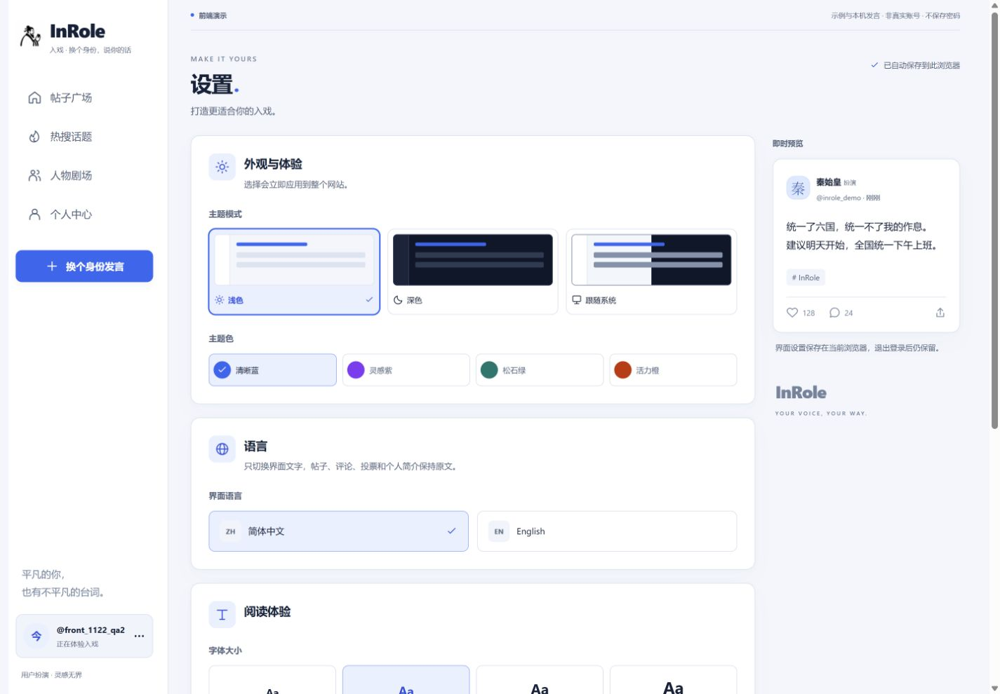
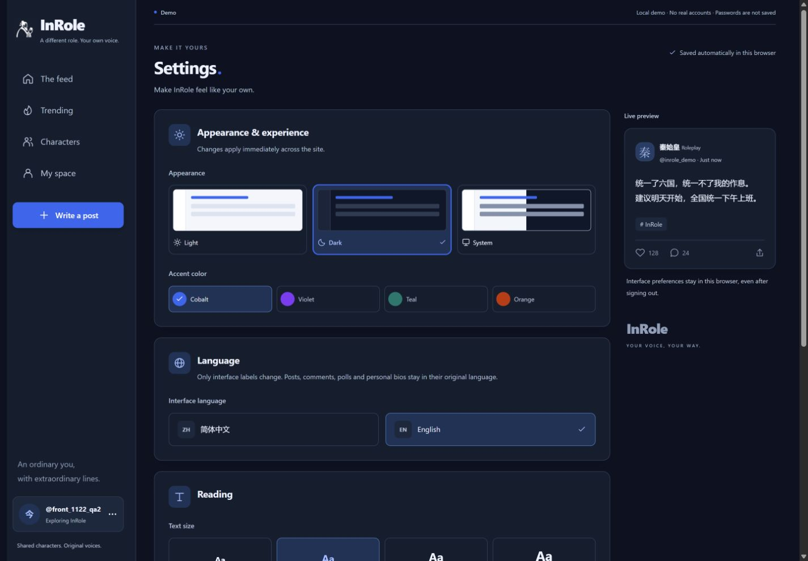
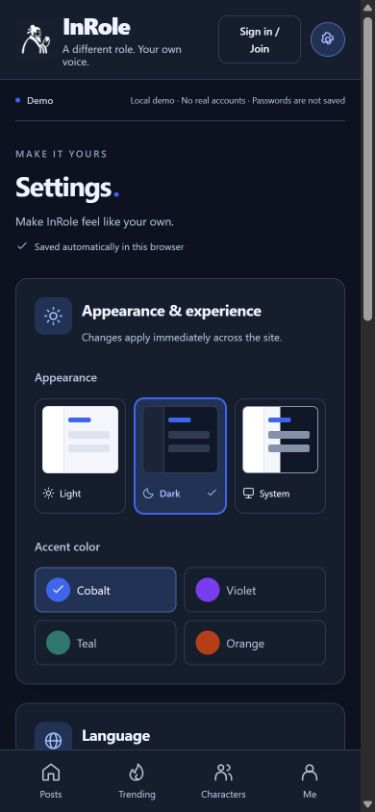
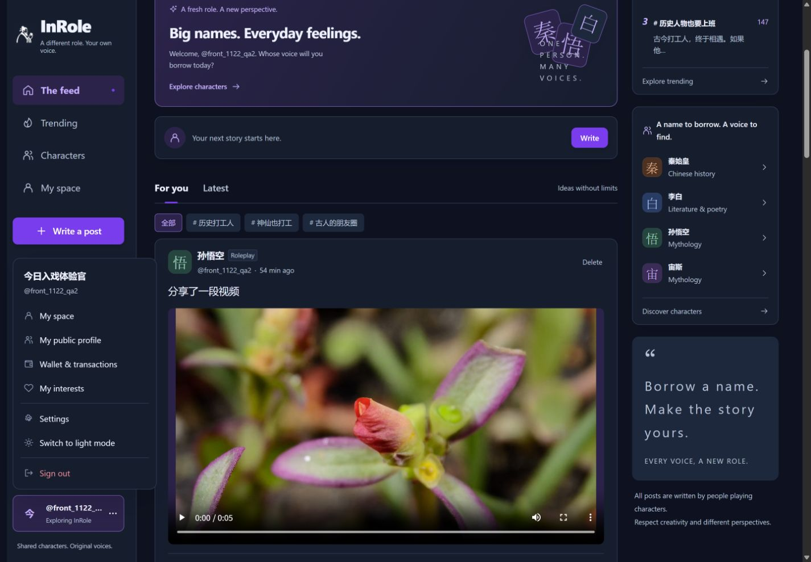

# 主题、语言、账号菜单与现代配色验收

日期：2026-11-23。范围为用户要求的深浅主题、浅色视觉优化、账号弹出菜单、设置及中英文/字体等阅读偏好。未接入真实后端或部署。

## 交付与数据边界

- 统一语义颜色：冷白/灰蓝的浅色背景，清晰文字与蓝色操作强调；深色覆盖卡片、导航、输入、弹窗、个人中心、热搜及申请页。保留原Logo和人物内容。
- /settings公开访问，提供浅色/深色/跟随系统、蓝/紫/绿/橙、中文/English、四档字号、舒适/紧凑布局、减少动画；右侧即时预览保留中文示例正文。
- 左下头像改为账号菜单，手机右上提供相同入口。登录后有个人中心、公开主页、钱包、喜好、设置、主题快捷切换和退出；游客仅显示界面设置与主题快捷切换。业务授权不改动。
- 偏好存在独立的localStorage键inrole.ui.preferences.v1，刷新/退出保留；storage事件同步同源标签页。主题跟随系统时监听配色变化；头部初始化脚本先应用已保存主题，减少刷新时闪色。
- 控件、导航、表单、状态等显式使用中英词典；没有翻译或改写原有帖子、评论、投票选项、人物原名、昵称和简介，也不调用在线翻译服务。
- 恢复默认只写界面偏好键，不清除社区状态、草稿、媒体、账号或钱包。浏览器禁止保存时使用内存并显示未持久保存提示。

主要文件：src/lib/ui-preferences.ts、use-ui-preferences.ts、ui-messages.ts、use-i18n.ts；components/preferences-provider.tsx、account-menu.tsx、interface-settings.tsx；app/settings/page.tsx、appearance.css。原CSS中的颜色与字号改用共享变量，原组件接入显式界面翻译。

## 自动检查

最终运行 `npm.cmd run check`，退出码0：lint零警告、TypeScript、28项测试与生产构建全部通过；新增/settings路由成功构建。没有增加依赖。

3项新增测试：损坏/非法偏好安全回退；动态界面文案插值与参数顺序保留账号/人物名称；未知正文保持原样。原有25项账号、内容、身份、权限、戏币、媒体、投票及人物申请测试继续通过。

## 浏览器实际验证

使用内置浏览器访问http://localhost:3000，沿用专用演示账号front_1122_qa2；未创建真实账号、未发送外部消息、未清空社区数据。

| 检查 | 观察结果 |
| --- | --- |
| 浅色 | 默认冷白/灰蓝背景、白卡片、蓝色强调，设置与帖子显示清晰 |
| 深色 | 切换后body背景rgb(12,18,32)，卡片/表单/导航同步变深；刷新后仍为深色 |
| 跟随系统 | 选择System后按当前系统配色解析为深色；未修改OS配色设置模拟系统变化 |
| 主题色 | 蓝、紫、绿、橙选择可应用；绿主按钮实测rgb(15,118,110)；重载保留已选紫色 |
| 英文 | 导航、设置、按钮、评论入口、时间与表单切换英文，html.lang为en |
| 原文保留 | post-01正文仍“统一了六国，统一不了我的作息…”；评论原文与@账号未变，时间与互动标签变英文 |
| 字号/密度/动画 | 大字号1.125、紧凑、减少动画刷新后均保留；超大1.25用于手机布局验收 |
| 账号菜单 | 登录后出现个人中心/公开主页/钱包/喜好/设置/主题切换/退出；手机和电脑都能打开 |
| 键盘 | 打开菜单聚焦首项；End到末项；Esc关闭并回到触发按钮 |
| 菜单主题快捷操作 | 点击Switch to light mode后主题变浅，菜单关闭 |
| 退出 | 新菜单退出成功，访客菜单只剩设置与主题；刷新保留深色和英文 |
| 恢复默认 | 恢复浅色、蓝、中文、标准字号、舒适、动画默认；post-01正文仍在 |

视口检查：

- 1440×1000：浅色/深色设置双栏、账号菜单、英文帖子与评论；无横向溢出。
- 390×844：深色英文设置；控件与底部导航可用，无横向溢出。
- 360×800、英文、超大字号1.25：首页、热搜、人物、人物榜、人物详情、帖子、话题、登录、注册；各页文档宽度均为345px（不超过360px视口）。
- 360×800账号菜单：left=61、right=329、top≈71、bottom≈498，菜单在视口内且退出项可见。
- 结束前恢复中文、浅色、蓝、标准字号等默认值，并清除临时视口覆盖，保留设置页预览。

## 未验证与后续

- 未进行真实手机、Safari/Firefox、读屏器或完整无障碍审计；系统模式验证当前配色，未实际切换操作系统设置。未通过浏览器策略强行禁用localStorage验证内存分支。
- 语言偏好目前在客户端读取；首次加载仍使用默认中文SSR后水合到保存的界面语言，未做服务端多语言预渲染。人物资料、话题原名等内容不做自动翻译。
- 偏好仅当前浏览器保存，尚未随账号跨设备同步；后续真实账号阶段可增加用户偏好表/字段。S07～S18保持未完成。
