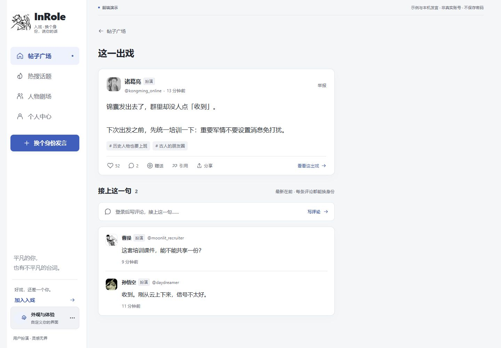

# 人物、网络头像与文字示例扩充验收

日期：2026-11-23。范围：再加入10位人物，为全部人物配网络头像，再增加10条帖子；本轮不新增视频。

## 交付

- 人物由12位扩充至22位。新增苏轼、曹操、诸葛亮、武则天、李清照、达·芬奇、莎士比亚、贝多芬、达尔文、居里夫人；每位都有分类、简介、独立ID，可进入人物详情并用于发言。
- 全部22张头像从Wikimedia Commons获取，保存为本地320×320 WebP，合计516916字节，页面显示不依赖外部图片服务。经过方形取景、缩放和压缩，检查了画像中的人物面部与实际页面加载。
- 原图许可记录为21张Public domain、雅典娜一张CC BY-SA 4.0。网页/people/credits公开展示每张图片的作品页、作者与许可；public/people/sources.json记录原图URL、作者、许可、获取日、裁剪参数和处理说明，SOURCES.md供阅读。图像改编沿用原图许可。
- 新增post-07～post-16共10条纯文字示例，每位新人物对应一条原创扮演台词、独立@账号和话题；配套20条相互接话评论、时间和演示点赞，沿用全站前端演示标记。不新增附件、视频或真实账号。
- demoSeedRevision=2标记已补充版本。既有浏览器仅追加尚缺的新示例及其评论/点赞；原有帖子正文、作者、删除结果、评论、投票、申请、评价、发布请求、最近人物和通宝流水保持。后续刷新不重复添加，删除或取消点赞后的新示例不会被补回。
- 版本补充在客户端挂载后进行；保存失败时保留原数据，并由现有内容错误提示显示，不能假报持久保存成功。

主要文件：src/lib/content-model.ts、demo-content.ts、person-portraits.ts、portrait-sources.ts；components/ui-provider.tsx、portrait-credits.tsx、people-directory.tsx、interface-settings.tsx；app/people/credits/page.tsx；public/people/。

## 自动验证

最终运行`npm.cmd run check`退出码0：ESLint零警告、TypeScript、37项测试、生产构建全部通过；/people/credits成功构建。没有新增依赖。

新增3项实质测试覆盖：在有用户发言、评论、点赞、删帖及通宝收支的旧数据上补充；重复刷新及补充后删帖/取消点赞不回填；部分新示例已存在时不覆盖或重复注入互动。

独立素材检查确认22个文件均能解码为320×320，均带作者、作品页与许可记录，总体积约505KiB。

## 浏览器实际验证

使用内置浏览器打开已有本机演示数据，没有清空存储、创建账号或手动发布额外帖子。

| 检查 | 结果 |
| --- | --- |
| 人物页 | 22张人物卡，滚动加载后22张头像均成功解码 |
| 旧浏览器新帖 | 当前共21条帖子，包含post-07～post-16全部10条新示例；刷新后仍为21条、10条新示例，无重复 |
| 新帖详情 | 诸葛亮的新帖、实际@账号、话题、52个示例赞及2条接话评论正常；诸葛亮/曹操/孙悟空头像均加载 |
| 新人物详情 | 居里夫人头像、介绍、发言入口与post-16正确关联 |
| 搜索 | 输入苏轼仅剩1张卡片，头像为本地sushi.webp |
| 来源页 | 22条署名，44个HTTPS原始作品/许可链接，手机无横向溢出 |
| 1440×1000 | 人物页宽1425px，未超视口；帖子详情正常 |
| 390×844 | 帖子及深色人物详情宽375px，未超视口 |

结束时清空临时人物搜索、恢复浅色、清除视口覆盖并关闭验收标签页。旧浏览器此前已有1条演示视频，该记录和其附件未删除；本轮10条新帖均不包含图片或视频。

未进行真实手机、跨浏览器、读屏或禁止本地存储的人工测试；存储仍是浏览器本机演示，未接真实后端、推荐算法或部署，S07～S18状态不变。
