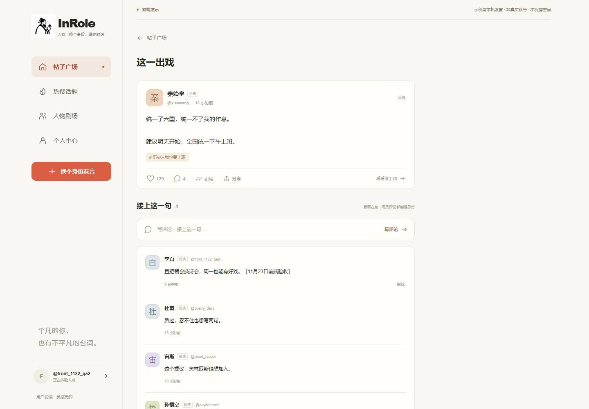
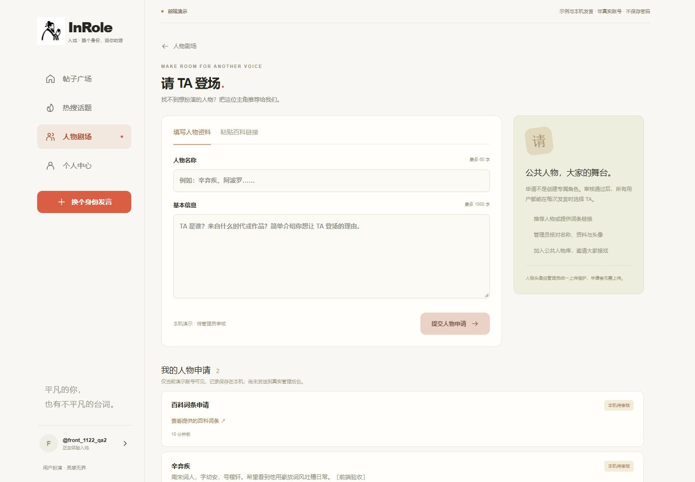
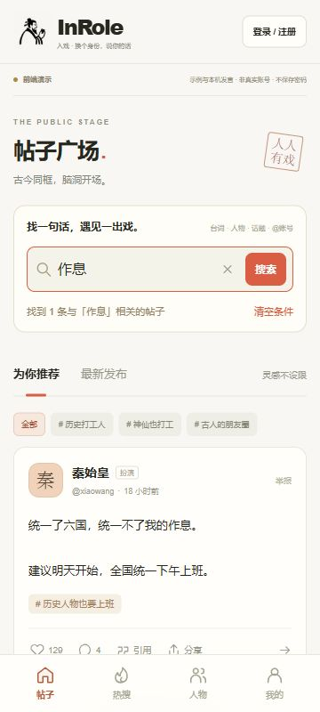

# 2026-11-23 前端扩展验收

用户范围：广场关键词搜索、公共人物申请、管理员头像预留、评论默认折叠、图片/视频/投票/引用/分享。保留S01～S06及既有docs，S07～S18保持未完成。

## 实施结果

- 搜索区移到广场标题下，匹配正文、投票问题/选项、人物、话题与账号；显示数量、清空和空状态；搜索时收起欢迎卡，保留排序与筛选。没有实现搜索索引或相关性算法。
- /people/request支持资料与百科链接两种申请；人物库、选择器和个人中心均有入口。校验受信百科域名/路径，拒绝伪装域名；仅保存本机待审核记录，不自动创建人物、不抓取百科、不向任何管理员发送消息。退出后申请入口要求重新模拟登录。
- Person.avatarUrl与person-portraits映射、统一图片头像/失败回退已接好；管理员上传、素材处理与审核仍待S15。没有为普通用户开放公共头像修改权限。
- 帖子详情不再渲染默认展开的人物选择器。点击简洁写评论入口才打开编辑弹窗，评论独立选择人物，发布后关闭弹窗并更新评论列表。
- 图片/视频保存到IndexedDB，帖子只存文件元数据；刷新可读取，展示用对象URL及时释放；添加失败显示错误，发布前核对附件存在；6张5MB图片或1个30MB视频，类型/大小/组合限制明确。
- 单选投票、有效期、每账号一票、查看结果；引用保存原帖ID并可查看原帖，原帖删除后仅显示不可用提示。
- 分享提供复制文案、系统分享、本机链接复制说明；本地附件不会随文字自动发送，当前链接不声称可跨设备读取。没有实际向微信、QQ或其他第三方发送任何帖子。

## 自动检查

最终 `npm.cmd run check` 退出码0：lint、typecheck、25项测试、Next.js生产构建均通过。没有新增依赖。

新增7项测试覆盖：富内容与纯媒体发帖、图片/视频类型和大小及混用拒绝、投票选项和时长、投票幂等/唯一/截止/删除级联、人物申请校验与去重、百科链接边界、旧数据兼容及删除引用不泄露正文。原有18项账号/权限/戏币等测试全部保留并通过。

存储版本仍为v1，缺失pollVotes和characterRequests的旧记录补空数组，旧帖子、评价与钱包原样保留。TypeScript启用allowImportingTsExtensions供原生Node测试直接加载拆出的规则模块，无运行时TS构建产物。

## 浏览器实际验证

使用本地开发预览http://localhost:3000与专用演示账号front_1122_qa2。未清空或重置用户数据，保留已有abcd等演示内容。

| 检查 | 观察结果 |
| --- | --- |
| 搜索 | 作息匹配1帖；不存在关键词匹配0；投票问题“几点下班”匹配新帖；数量与空状态正确；清空回全部 |
| 申请权限 | 游客进入申请转/login?next=%2Fpeople%2Frequest；登录后回申请页 |
| 资料申请 | 辛弃疾＋基本信息提交后本机待审核列表显示1条 |
| 链接申请 | wikipedia.org.evil.test被拒；真实百科域名词条接受并去掉query/hash；刷新保留2条申请 |
| 默认评论 | post-01没有人物选择区域，直接显示已有评论与写评论入口 |
| 评论弹窗 | 点击后选李白并评论成功；弹窗关闭、评论数3→4，旧帖人物不变 |
| 图片 | 选择自有Logo PNG，成功预览；发布后刷新naturalWidth>0，附件仍在 |
| 富内容草稿 | 图片、正文、投票、时长3天和原帖引用关闭重开均保留 |
| 组合发布 | 宙斯发布正文＋图片＋投票＋引用post-01，进入新帖详情 |
| 投票 | 选“立刻下班”后显示1票、100%；刷新仍已投、选项禁用 |
| 视频 | MDN CC0测试视频上传、无正文发布、刷新读取，duration=5.055、readyState=4、无媒体错误；按Space后paused=false，实际进入播放 |
| 混合附件 | 视频草稿再加图片被拒，原视频仍在 |
| 分享 | 复制文案与实际剪贴板内容一致，包含人物、作者、正文及投票；未执行系统外发或向第三方发消息 |
| 选择器申请链接 | 发帖弹窗内进入人物申请，弹窗确实关闭；不会遮住申请表；草稿保留 |
| 游客新操作 | 退出后投票、引用、分享均转登录并保留对应帖目标 |

视频测试素材：[MDN CC0 flower.mp4](https://interactive-examples.mdn.mozilla.net/media/cc0-videos/flower.mp4)，仅测试用途，临时源文件位于系统Temp，不提交到项目。

## 视觉与环境

- 360×800：搜索、投票编辑弹窗、人物申请；文档宽度不超过视口。长弹窗自身滚动，发布按钮可到达；表单输入16px。
- 390×844：富内容帖子，图片、投票和底栏显示正常，无横向溢出。
- 768×1024：人物申请宽度正常，布局改为单列。
- 1440×1000：默认评论及人物申请双栏正常，导航高亮正确。
- 未在真实手机/软键盘或多个浏览器实机验收。头像管理上传、云媒体服务、系统分享目标App与平台卡片未实测，不标为已接通。

开发验收中Tailwind自动扫描design/deck里由其他程序锁定的mso临时文件，导致Turbopack错误。依据[官方扫描范围文档](https://tailwindcss.com/docs/detecting-classes-in-source-files)，将globals.css的Tailwind source限定到src；保留设计文件，未终止用户程序。随后页面恢复，继续完成浏览器验收与最终生产构建。

系统分享采用[W3C Web Share API](https://www.w3.org/TR/web-share/)；可用目标由设备/浏览器提供，当前实现不会承诺固定出现微信或QQ，不会把调用系统选择器视为已发送成功。

## 后续接入

- S07/S10：人物申请、媒体对象/帖子关联、投票与票记录、引用关系表；服务端会话与对象存储授权；类型/大小/内容独立校验和限流，删除/备份与媒体清理策略。
- S15：申请审核、公共头像上传与来源记录、权限控制和审计；普通用户不能直接入库或改头像。
- S17：公开链接与媒体访问、HTTPS、平台分享配置和真实手机验证。此阶段媒体仅在本机，未连接云数据库或部署服务。
