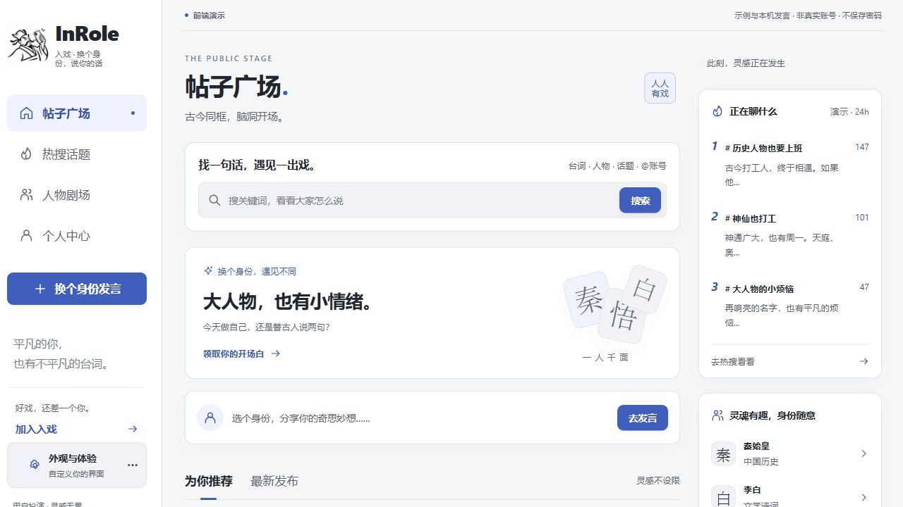
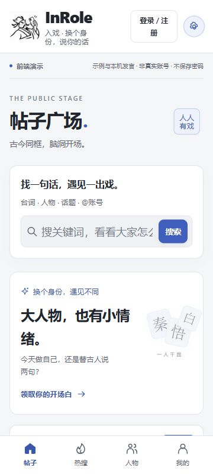

# Logo放大验收

日期：2026-11-23。用户要求Logo图标大一点。

- appearance.css将网页Logo设为电脑60×60，手机52×52，手机登录注册页同步52×52。
- 图文间距8px，品牌容器限制为父级宽度，文字可收缩并均衡换行，保持图片比例。
- npm.cmd run lint、npm.cmd run typecheck、npm.cmd run build均通过。副标题换行调整后再次构建通过。仅改样式，没有新增或重跑业务模型测试。
- 内置浏览器实测1280px首页Logo宽60px；360px首页及登录页Logo宽52px，文档宽345px。手机品牌右缘约199px，右侧控件起点约211px，保留12px间距，无遮挡或横向溢出。
- 未修改账号、内容或显示偏好；验收后恢复视口并关闭临时标签页。未做真实手机或跨浏览器测试。

