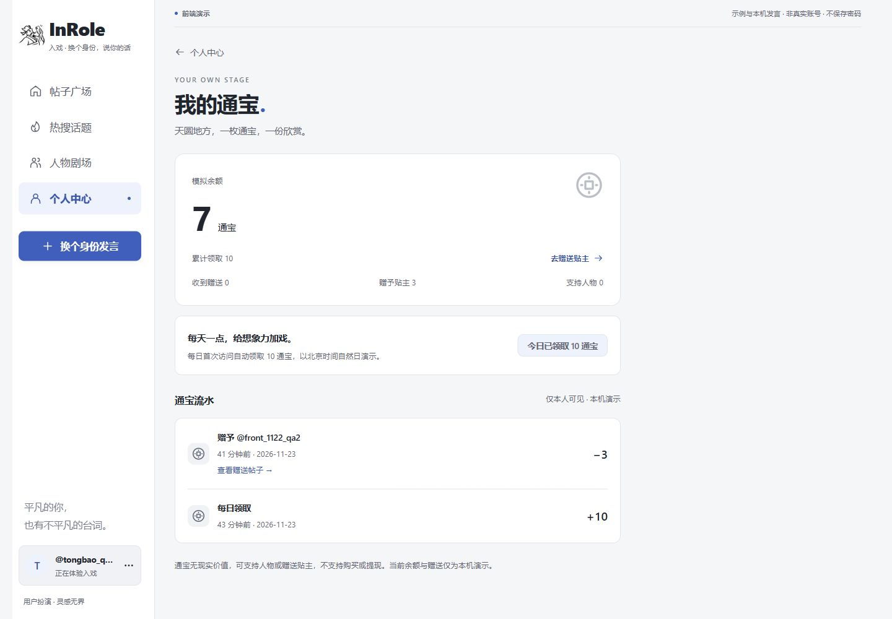
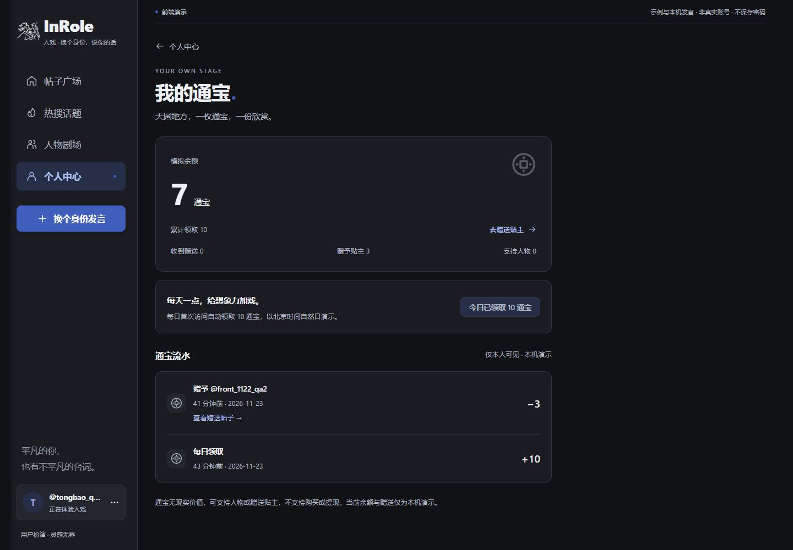
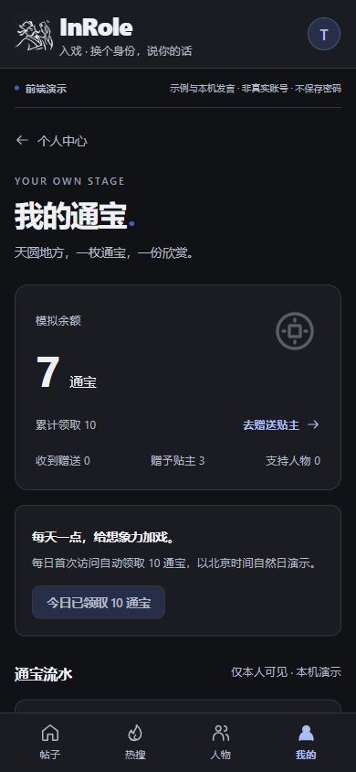

# 新Logo与通宝中性色验收

日期：2026-11-23。范围：应用用户提供的新Logo，并使通宝显示与其他UI颜色一致。

- 原图itirxp3jvsrmwt1fba2.jpg完整复制到public/brand/inrole-logo-v2.jpg，SHA256一致，没有裁剪或重绘。通过现有sharp生成64×64浏览器图标和180×180Apple图标，无新增依赖。
- Brand共用组件覆盖电脑导航、手机页头、登录/注册等入口。新路径避免原Logo图片缓存；metadata同步icon、shortcut icon和apple-touch-icon。
- 继续使用浅色multiply、深色invert与screen显示适配，Logo保持比例，不挤压文字。此前Logo和用户下载原图保留。
- 赠送按钮普通状态与评论同色；通宝徽标、余额、输入、快捷数量、钱包、流水及人物收币数使用现有灰阶变量。确认按钮与链接沿用普通操作颜色；已赞红心保留。

主要文件：src/components/brand.tsx、src/app/layout.tsx、src/app/appearance.css、public/brand/。素材说明见public/brand/README.md。

最终`npm.cmd run check`退出码0：lint零警告、类型检查、34项测试、生产构建全部通过。此次为素材和样式调整，未新增样式镜像测试。

内置浏览器实际检查：

| 检查 | 结果 |
| --- | --- |
| 网页品牌 | 桌面与手机可见Logo均加载新v2路径；登录页同步新Logo |
| 页面图标 | icon与shortcut均为inrole-icon-v2.png，Apple为inrole-apple-icon-v2.png |
| 浅色工具栏 | 赠送与评论颜色均为rgb(91,99,112) |
| 浅色弹窗 | 通宝徽标rgb(91,99,112)，中性底rgb(240,242,245)；余额为正文色rgb(32,37,46) |
| 深浅钱包 | 浅色白卡片、深色rgb(25,28,34)卡片；数字跟随正文色，不再蓝色 |
| 1440×1000 | 新Logo、钱包、流水布局完整，文档宽1440px，无横向溢出 |
| 390×844 | 新Logo显示清晰，深色钱包正常，文档宽375px，无横向溢出 |

沿用专用本机演示账号tongbao_qa_1123，仅打开弹窗和浏览钱包，没有赠送、点赞、创建或删除内容。结束时恢复中文浅色、退出验收账号、清除临时视口并关闭标签页。未验证真实手机主屏安装或跨浏览器图标缓存刷新；S07～S18状态不变。

