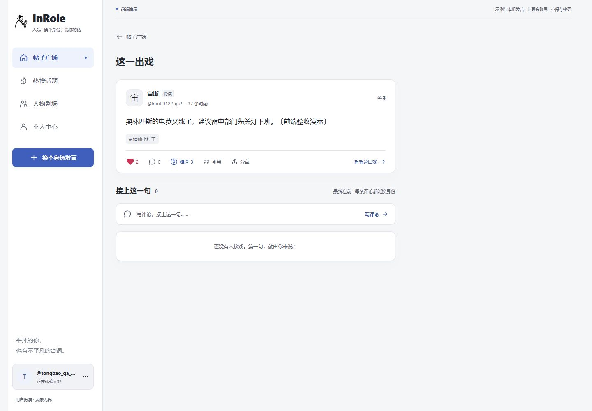
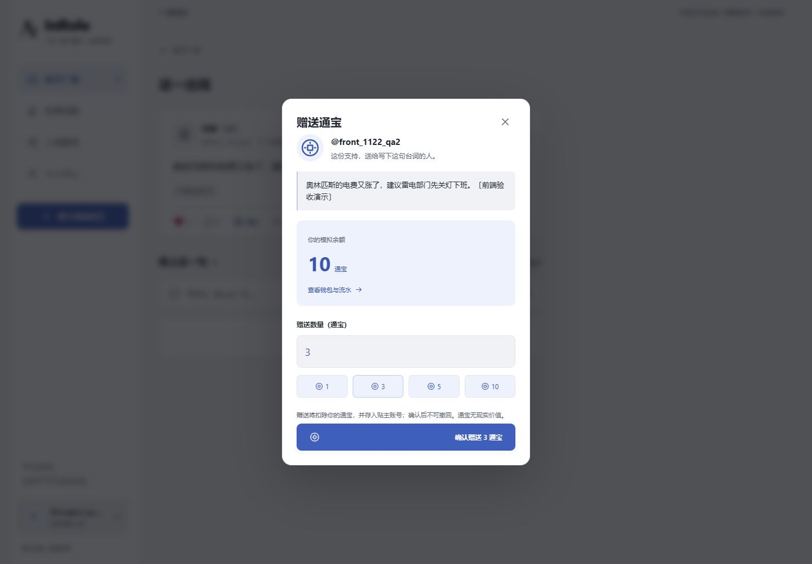
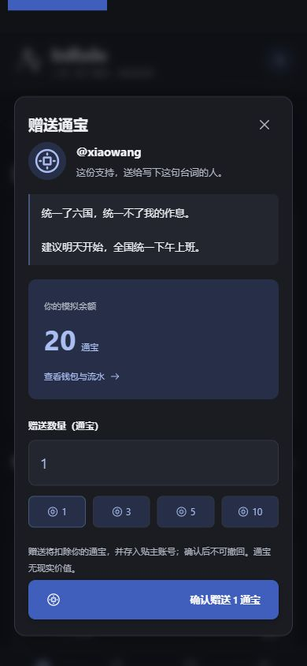
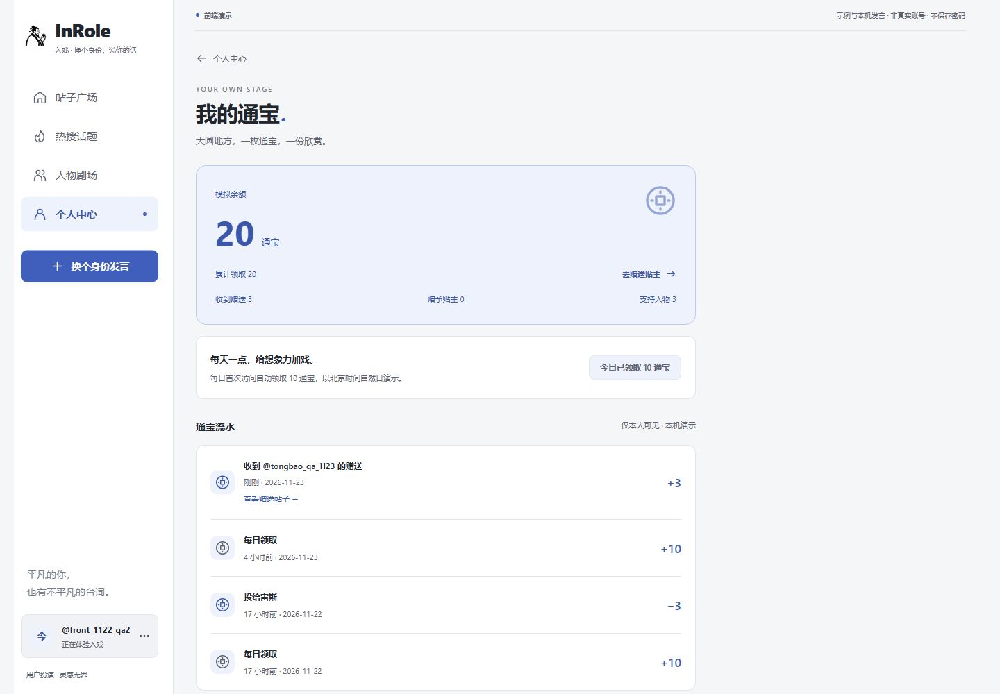

# 红色爱心、通宝命名与帖子赠送验收

日期：2026-11-23。范围：已赞爱心改红色；货币改称通宝，使用圆形方孔钱图标；帖子支持赠送实际贴主。每日10枚的领取规则继续保留。

## 交付

- 已赞爱心浅色#d63854、深色#ff728d，填充和文字同步；其他主操作继续使用墨蓝色。
- 中文界面货币统一为通宝，英文Tongbao；钱包、人物、个人中心、弹窗、页面标题和提示同步更新。图标是原生SVG圆形方孔钱，不增加依赖或图片请求。
- 帖子工具栏添加赠送，展示累计收到数量；弹窗明确实际贴主@账号，支持手输数量及1/3/5/10快捷选择。游客先登录，自己的帖子不能自赠；超额、负数、小数和无效数量不能结算。
- 一条gift记录包含送出者、实际贴主、原帖、金额和幂等请求；同一记录同时计算双方收支，整份状态一次写入localStorage。接收方从原帖作者读取，不接收用户传入的收款账号。
- 钱包展示领取、人物投币、赠出与收到的通宝；收款可继续使用。赠送不增加公共人物投币统计，不改变评分或现有热搜公式。删除原帖保留结算流水，拒绝新赠送。
- 保留内容存储键和版本，旧grant/tip流水仍有效，不清除账号、内容、钱包或媒体。反序列化校验新增赠送格式、收款人、重复记录和余额。
- 手机工具栏五项互动紧凑排列，移除多余详情链接行；帖子正文和发言仍可进入详情。

主要文件：src/lib/content-model.ts、demo-content.ts、ui-messages.ts；src/components/post-gift.tsx、post-card.tsx、account-pages.tsx、icon.tsx；src/app/appearance.css、interactions.css。其他显示货币的现有组件同步更名。

## 自动检查

最终`npm.cmd run check`退出码0：ESLint零警告、TypeScript、34项测试、生产构建全部通过。

新增6项实质测试：实际作者收支与人物区分；访客/自赠/无效数量/时间/余额拒绝；幂等与连续大额赠送防超支；删帖后的流水和请求保留；收到通宝继续使用与每日领取独立；旧钱包兼容及损坏记录拒绝。现有翻译测试补充赠送账号与数量插值，帖子正文继续保持原文。

## 浏览器实际验证

使用内置浏览器访问http://localhost:3000。新增专用本机演示账号tongbao_qa_1123，向既有验收账号front_1122_qa2的一条演示帖子赠送3通宝，测试记录保留；没有创建真实账号、发送外部消息或清空数据。

| 检查 | 观察结果 |
| --- | --- |
| 游客 | 点赠送转登录，保留原帖目标，没有自动扣款 |
| 数量 | 余额10时输入11，确认按钮禁用；选择3可提交 |
| 赠送结算 | 提示成功，帖子显示收到3；刷新后仍为3 |
| 送出方钱包 | 领取+10、赠出−3，余额7，赠予贴主累计3 |
| 接收方钱包 | 显示收到tongbao_qa_1123赠送+3；累计领取20−原人物投币3+赠送3=余额20 |
| 自赠 | 接收方打开自己原帖，赠送按钮禁用 |
| 浅色红心 | 已赞SVG填充rgb(214,56,84) |
| 深色红心 | 已赞SVG填充rgb(255,114,141) |
| 手机 | 390×844深色帖子、赠送弹窗可用；文档宽375px，无横向溢出 |
| 英文 | 360×800赠送弹窗翻译完整，原帖中文摘要未变；弹窗宽324px。英文钱包文档宽345px，无横向溢出 |
| 清理 | 撤销对post-01临时增加的测试点赞，恢复中文浅色，退出验收账号、清除视口覆盖并关闭临时标签页 |

## 限制

当前仍为本机演示：账号ID、赠送、日期与余额均在当前浏览器，不具有真实认证、多设备同步或多标签页并发事务保障。真实后端阶段须用服务器时间、数据库余额锁/事务及幂等唯一约束实现同样规则。未验证真实手机、Safari/Firefox或完整读屏无障碍；S07～S18未标记完成。
