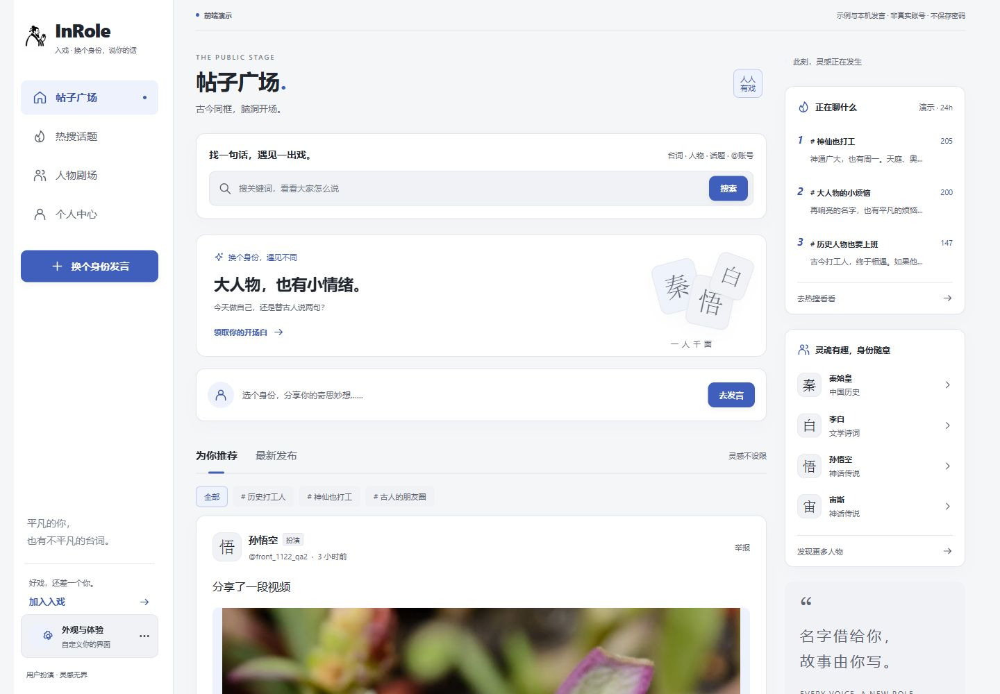
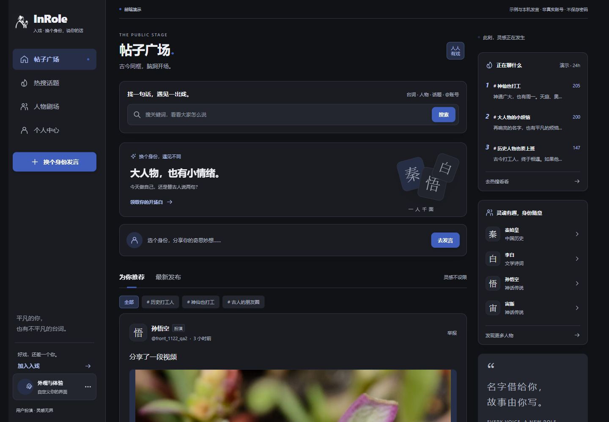
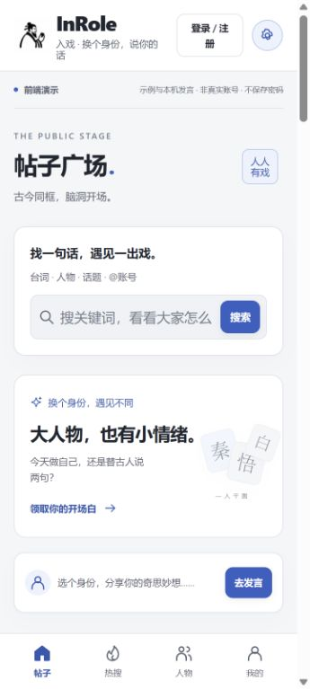
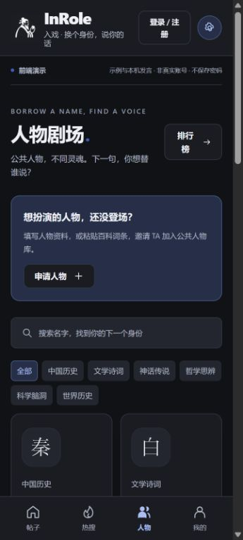

# 统一墨蓝色与深浅主题验收

日期：2026-11-23。范围：用户要求只保留一种协调的主色，并适配浅色和深色。本记录替代2026-11-23-appearance.md中的四种主题色方案；原报告作为历史保留。

## 实现

- 主操作统一墨蓝色#315cbd。浅色背景#f5f6f8、卡片#ffffff；深色背景#101216、卡片#191c22，文字和选中态按模式调整可读性。
- 去掉彩色头像占位、金色评分、大面积彩色欢迎背景；导航、评分、按钮和选中态共用强调色，其他容器使用中性灰阶。错误和删除仍保留红色语义。
- 设置页移除主题色选择，保留浅色/深色/跟随系统、语言、字号、密度、动画及账号入口。
- 偏好解析与首屏初始化统一使用blue；旧violet/teal/orange会归一，主题、语言、字号、密度和动画偏好继续保留。同一localStorage键版本兼容既有数据。
- 删除globals.css中旧橙色默认变量，颜色集中在appearance.css；不增加依赖。

主要文件：src/app/appearance.css、globals.css、layout.tsx；src/components/interface-settings.tsx、preferences-provider.tsx；src/lib/ui-preferences.ts。

## 自动检查

最终运行`npm.cmd run check`，退出码0：ESLint零警告、TypeScript、28项测试、生产构建全部通过。原有偏好解析测试补充了三种旧主题色的归一与其他设置保留断言；未为样式增加镜像测试。

## 浏览器验证

使用内置浏览器访问http://localhost:3000。保留原有演示内容、账号、钱包及媒体，没有发布帖子或清空存储。验收期间刷新了开发服务以更新旧样式缓存。

| 检查 | 观察结果 |
| --- | --- |
| 浅色首页 | 灰白背景、白卡片、墨蓝色操作，人物占位统一灰阶 |
| 深色首页 | body背景rgb(16,18,22)，卡片与欢迎区rgb(25,28,34)，文字清晰 |
| 人物列表 | 前六个人物头像占位在深色下均为rgb(34,38,46)，不再按人物分多种颜色 |
| 设置 | 不再出现主题色选择，浅/深主题切换与刷新持久化有效；主题缩略图同步新色值 |
| 1440×1000首页 | 深浅模式均完成截图；文档宽1425px，不超过1440px视口 |
| 360×800首页、设置和人物页 | 深浅设置及浅色首页、深色人物列表正常；文档宽345px，不超过360px视口 |
| 结束状态 | 恢复浅色，清除临时视口覆盖，关闭独立验收标签页 |

浅色与深色效果：

本轮为视觉与显示偏好调整；未重复完整注册/发帖流程，未进行真实手机、Safari/Firefox或完整无障碍审计。旧色偏好迁移由自动测试覆盖，未改写浏览器存储植入旧值。S07～S18仍未完成。
