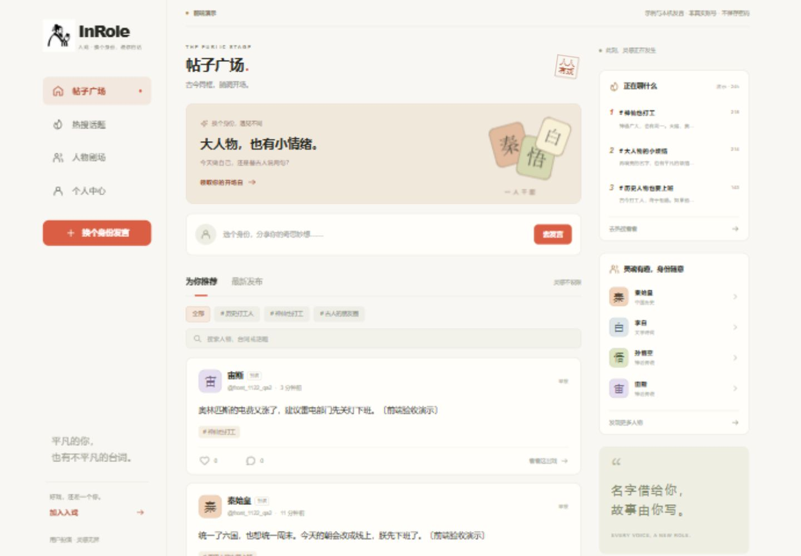
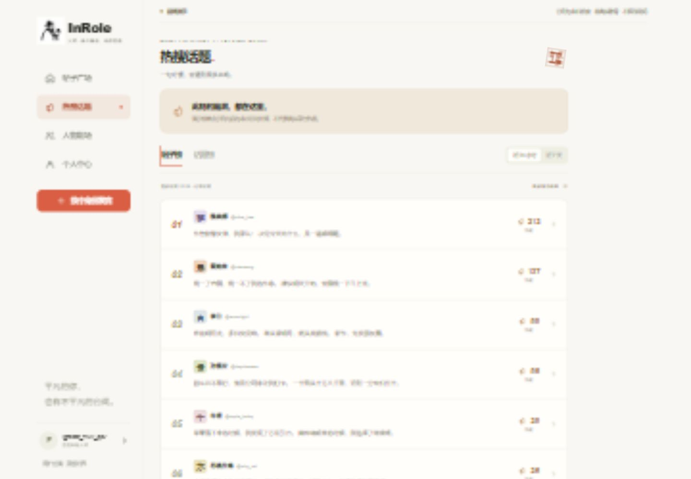
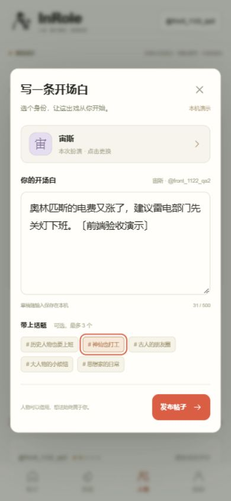

# S04 / S05 / S06 验收记录

日期：2026-11-22，Asia/Shanghai。范围：四大模块可操作前端，本机演示数据和模拟登录；不包含S07以后的真实后端服务。

## 交付

- S04：公共人物选择器（搜索、分类、最近使用）；独立人物发帖/一级评论，正文1～500个Unicode字符、帖子0～3个话题；本机草稿、发布锁与请求幂等；点赞/取消、本人删除确认、他人帖子本机举报。
- S05：帖子榜/话题榜，24小时/7天，更新时间与刷新，按去重互动计算；话题详情、相关帖子和带话题发帖。榜单可进入对应帖子或话题，不使用随机热度。
- S06：12个公共人物、搜索/分类、人物详情、1～5评分和文字评价（修改/删除）、投币确认、三类人物榜；个人中心四类记录、公开主页、昵称/简介、喜好、模拟钱包和分页流水。
- 所有写操作通过当前模拟会话入口校验；游客只读。状态、草稿和记录按账号组织；作者与本次人物分别保存。普通模拟账号不能调用删除他人内容的动作。
- 统一状态层保存在localStorage，当前会话在sessionStorage。密码不保存、不验证。损坏数据保留并提示；写入失败不提示成功；重置先保存备份，恢复需确认与模拟登录。
- 保留此前所有文档与Logo资产。/rankings对应的人物导航已高亮；不同帖复用评论请求号不会产生重复评论ID。

## 自动检查

最终运行 `npm.cmd run check`，退出码0：

| 检查 | 结果 |
| --- | --- |
| lint | 通过，0警告 |
| typecheck | 通过 |
| test | 18项通过：4项账号规则，14项内容/热度/评分/戏币/举报模型规则 |
| build | 通过，页面与动态路由构建成功 |

模型测试覆盖同一账号多人物与共享人物、历史身份不变、游客/非法作者拒绝、Unicode正文与话题限制、请求幂等与跨帖评论ID、点赞去重、删除所有权与级联、持久化反序列化、近期热度去重及排除自己、北京时间跨日领币、投币与余额一致、超余额及重复请求、改评分不增人数、损坏流水/评价拒绝、本机举报去重。

这些是本机模型检查，不能替代真实服务端授权、数据库事务和并发测试。未新增依赖。

## 浏览器实际验收

使用内置浏览器访问http://localhost:3000，通过界面创建独立演示ID `front_1122_qa2`，使用专用演示密码；保留原有浏览器资料，没有清空或重置已有内容。

| 路径/动作 | 观察结果 |
| --- | --- |
| 游客点128赞的秦始皇帖子 | 跳登录并保留原帖目标；登录后没有自动点赞 |
| 注册→喜好→原目标 | 表单仅ID/密码，选中国历史后回原帖 |
| 发帖草稿 | 秦始皇、正文与话题在关闭后重新打开均保留 |
| 发帖边界 | 第4个话题禁用；501字禁用发布；修正后可发 |
| 第一篇发帖 | 秦始皇 · @front_1122_qa2，发布后进入稳定的本机帖子详情 |
| 独立评论 | 同一账号选择孙悟空评论；原帖人物仍为秦始皇 |
| 点赞/取消 | 0→1，刷新后仍为已赞；取消回0 |
| 删除确认 | 自己的评论弹出确认，选择保留后内容仍在；实际删除/越权/级联在模型测试验证 |
| 热搜 | 帖子/话题与24小时/7天可切换；帖子榜进入post-05，话题榜进入古人的朋友圈 |
| 话题参与 | 打开发帖弹窗，古人的朋友圈已预选 |
| 人物搜索 | 搜宙斯只显示匹配卡片，点击进入人物详情 |
| 评分 | 5分提交后人数5→6；改为2分后仍6人，均分3.5，刷新保留 |
| 投币 | 起始余额10；11币与1.5币禁用确认；投3成功，宙斯累计8→11 |
| 钱包 | 余额7、累计领取10、累计投出3；两条流水+10/-3，反复刷新不重复领币 |
| 人物榜 | 评分/今日/累计榜可切，今日宙斯显示11币，累计榜行回到宙斯 |
| 个人中心 | 帖子/评论/点赞/评价切换正确；取消点赞后列表为空；余额7与钱包一致 |
| 喜好编辑 | 增加神话传说，保存刷新后仍选中 |
| 资料编辑 | 保存“今日入戏体验官”及简介，刷新后公开主页正确显示，不显示钱包 |
| 第二人物 | 手机人物页以宙斯身份发第二篇；回第一篇仍是秦始皇 |
| 退出/游客 | 退出后个人中心跳登录；评分、投币、发帖、评论和直达钱包均跳登录并保留安全目标 |
| 运行日志 | 未观察到错误；开发时修改共享模型产生一次Fast Refresh全页刷新警告 |

## 响应式与截图

使用浏览器视口模拟检查，未冒称真实手机测试：

- 360×800：首页、热搜、话题、人物目录/详情、人物榜、个人中心、钱包、设置、喜好页，文档宽度不超过视口；热搜行和底部导航正常。
- 390×844：人物详情、选中人物的发帖弹窗；正文、话题和发布按钮可见，弹窗无横向溢出；成功发出第二篇。
- 768×1024：个人中心，统计、资料、钱包入口和底部导航正常，无横向溢出。
- 1440×1000：首页三栏、热搜列表、人物榜；侧栏导航与当前项正常，无横向溢出。
- 弹窗为原生dialog，支持Escape/关闭与焦点恢复；关闭重开草稿已实际验收。真实移动软键盘、读屏器和跨浏览器兼容留待S16。

## 复验步骤与边界

1. 启动 `npm.cmd run dev`，访问http://localhost:3000。
2. 注册一个新的本机ID和任意合规演示密码，选择喜好或跳过。
3. 秦始皇发帖，孙悟空评论，再宙斯发帖；刷新确认人物和作者未混淆。
4. 人物页评分后修改，投3币；在人物榜及“我的→钱包”核对人数、收币、余额和流水。
5. 退出，确认所有互动和私有页面要求重新模拟登录。

当前内容只在当前浏览器中保存，全部本机演示账号共享公共内容；换设备不同步。模拟登录不提供真实身份验证、数据保密或防篡改能力。戏币和本地时间仅作流程演示；真实发放日期、金额、幂等与并发控制在S12由服务端落实。

重置/恢复入口未在浏览器中执行，避免影响既有本机内容；存储损坏与非法数据通过纯模型测试验证，浏览器禁用存储没有实际切换验证。举报只保存在本机，未向任何人发送消息。未连接云数据库、未部署、未实现推荐算法或管理员后台，S07～S18保持未完成。

Git仓库当前尚无项目提交（文件仍为未跟踪状态）；未替用户配置作者信息或连接远程仓库。
